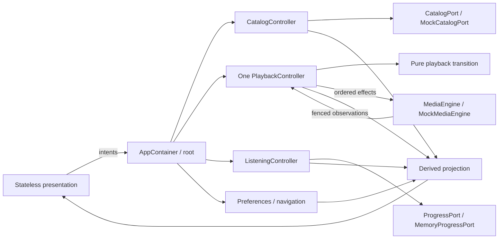

# Theatre CMP mock architecture and evidence

Status: implemented mock architecture; JVM verification and Android compilation recorded below.
This follows the requested 407-line architecture brief, preserves the existing stack and stays
on [draft PR63](https://github.com/loveoverflowcom/cantos/pull/63). The
[phase1 checkpoint](mock-skeleton.md) is commit `2a425a87ab20aba4061d2910bf02df62c32652e9`.
There is one KMP shared module, no extra service/crate, no FFI and no generic MVI framework.

## Ownership and execution

`AppContainer` creates one playback controller and one engine for the app owner. Android retains
that container in its Application; desktop retains it above the Window; iOS SwiftUI retains an
`IosDemoOwner` through `StateObject`. The root composition accepts an injected container and
does not dispose a caller-owned one. Its default diagnostic owner closes with the root composition.
Navigation, detail, player and settings do not construct another engine. Native lifetime behavior
still needs device/simulator evidence; compiled common/JVM tests prove the app wiring with fakes.

| Owner | Authoritative value | Boundary |
| --- | --- | --- |
| `domain/publication` | synthetic Work/Episode keys and immutable catalog inventory | no approved release, asset URL, rights, API or framework dependency |
| `domain/playback` | generation/session, intent and observed fake-engine phase | pure `reducePlayback -> PlaybackTransition(nextState, effects)` |
| `domain/listening` | separate SavedWork, Bookmark and ProgressRecord collections | no completion inference, account, outbox or reconciliation policy |
| `application/catalog` | immutable catalog StateFlow and monotonic request tags | CatalogPort replies cannot replace a newer/reset request |
| `application/playback` | one serialized event loop and a separate ordered effect worker | only observation callbacks enter MediaEngine.events; matching source/generation required |
| `application/listening` | one ordered memory-write owner and typed store failure | ProgressPort I/O is outside state assignment; failed writes are not accepted |
| `application/preferences` / `app/Navigation` | independent preferences and pure navigation state | StateFlow.update functions perform pure transitions only |
| `features/shell/presentation` | supplied read-only projection/catalog metadata | emits intents; no fixture/reducer/port/I/O imports |

The root derives `DemoState` for rendering; it does not own a writable aggregate mirroring the
controllers. Query, library tab, timer selection and scroll remain screen-local. Fixture data
is under `adapters/mock`, separate from presentation metadata and domain rules. The current
six presentation identifiers are diagnostic fixture identifiers, not production publication IDs.
No DownloadedAsset/offline subsystem is added without a consumer.



Public intents and consumers use the host application dispatcher; tests inject a deterministic
dispatcher. Owned child scopes cancel without cancelling their caller. The pinned coroutines
dependency is 1.8.1; the [StateFlow source](https://github.com/Kotlin/kotlinx.coroutines/blob/1.8.1/kotlinx-coroutines-core/common/src/flow/StateFlow.kt)
documents read-only exposure, equality conflation and potentially repeated update transforms.
No effect or I/O is placed inside those transforms. The MediaEngine seam is mock-scoped;
Media3/AVFoundation, backend-authorized publications and production lifecycle policy are future
reviewed consumers, not implementations implied by these interfaces.

## Playback and reset invariants

- Play changes intent and emits a complete command. Only matching `EngineStarted` first confirms
  **simulating**, always with no-audio copy. No clock advances, media plays or timer runs.
- Effects contain identity, complete source, point and speed. Command acceptance is ordered and
  returns before acknowledgement; preparation races cannot wait on a discarded ready callback.
  A delayed start acknowledgement cannot restore an older speed.
- Source and generation jointly fence observations. Ready cannot roll running/paused/ended back;
  user pause wins, cold restore emits Prepare plus OfferResume and never Start.
- Rapid toggle and relative-seek intents resolve against the event loop's current state.
  Bookmark point capture follows preceding controls, then crosses to the independent listening owner.
- Reset increments a local epoch to discard pre-reset bookmark captures. Progress is blocked
  until an accepted restore barrier establishes its actual generation floor; older queued collector
  values cannot repopulate the reset snapshot. Controlled tests force both actor interleavings.
  Generations never wrap. A rejected restore does not establish a new progress baseline.
- Catalog source selection refuses missing/unsupported keys before navigation or engine commands.
  Opening a bookmark validates its source and point together; refusal cannot seek another episode.
  Bookmark projections/actions and marked-state comparison retain exact milliseconds; only clock
  labels use whole seconds, so distinct points within one second remain distinct.
  Unknown UI selections show recovery, never another work's substituted metadata.
- End position/engine end creates no completed-listen, rights or publication assertion. All
  stores are memory-only and disappear with process death.

## One shared corpus

The fixture-only commit `56bb39bcd769befd8385e7cb963b7ff4930f3c89` was explicitly approved and
cherry-picked as `1b8e56a980e095bc1d1346b95f0f975344082327`; no Web implementation is imported.
[Contract/data](../../../../packages/contracts/fixtures/theatre/playback/v1/README.md) is
`theatre-mock-playback@1`, vector_format 1. Its seven vectors contain 51 hand-authored steps.

- index SHA-256: `108503bdcceb36fe6351b1d320075d974615f7dc0ea560582bbe19c2da2b0485`
- schema SHA-256: `0c6130a831dd4486b07736888ed0f6df0f43d1faee68ce3a70fb5a9351c02000`

Gradle generates ignored common-test strings from exactly the index-listed bytes. Generation
checks every SHA-256 and rejects unlisted JSON; no language reducer generates expected outputs.
Tests compare the complete expected state, derived status/cause and ordered effects. The decoder
rejects unknown versions, fields, variants, containers, types, bounds and noninteger lexemes,
including `1000.0` and `-0`. Duplicate JSON keys retain the pinned Web parser's last-key behavior;
duplicate-key rejection is not a verified contract promise.

Source alignment used Web head `2990f3d0d4f10bdbb8c2c5a4548f657c2d95c988`; its authored Rust
tests were NOT_RUN in that executor and are not Kotlin/compiler evidence here. Kotlin/JVM,
Android runtime, iOS and Web results are distinct. The requester and Web owner confirmed the
boundary outside the corpus: already-requested Play remains a no-op after seek-to-end while
intent is Play; only an accepted new Play from paused/observed-ended at the end restarts at zero.
Both clients agree, and a separate Kotlin adversarial test covers the five non-ended phases
plus pause/restart without changing vector bytes. The shared README clarification is consumed
from its owner (`b4aa7e36c03c0c8e862fd5e038799a8bc33bad40` and
`7213fca7d043582350d45f02b277b0481a1807e1`, locally `aa9c8cb356d33a840ca0593883919c08c7865625`
and `65c206e0ffac406e3788747250032fc039d21532`); this adds no second corpus.

## Executed local evidence

Source: checkpoint/cherry-pick above plus the architecture working diff. Installed tools remain
Rust 1.87.0, Kotlin 2.2.20, Compose 1.9.0, Material3 1.8.2, Gradle 8.14.3, JDK21, Android
SDK35/build-tools35.0.0, macOS15.6 arm64. No toolchain, TLS, credentials or permissions changed.

| Command / evidence | Result | Supporting output / limit |
| --- | --- | --- |
| `cargo xtask theatre-demo verify` | **PASS** | 109 tests, zero failure/error/skip; XML13:22:15–17Z; `/tmp/cantos-cmp-phase2-verify-handoff.log` |
| Canonical common tests on JVM | **PASS** | all7 vectors/51steps, full state/effects; 15 reducer/factory tests plus16 strict corpus/parser tests |
| Fake-port/application integration | **PASS** | 18 catalog/listening/navigation/preferences tests, six playback-controller tests, nine app-scope/reset/bookmark tests |
| UI projections/resources | **PASS** | 11 immutable projection/catalog tests and nine locale/resource tests |
| Actual app JVM rendering | **PASS** | ten root interaction tests, eight direct presentation tests and seven capture tests/eight PNGs |
| `cargo xtask theatre-demo android-build` | **PASS** | final precision/owner build:55tasks,14seconds;8 executed/47up-to-date; `/tmp/cantos-cmp-phase2-android-handoff.log` |
| Phase1 full preflight / verify rust / verify contracts | **PASS**, retained baseline | all15 preflight gates, including disposable PostgreSQL and9/9mutation; Rust/xtask/backend sources are unchanged in phase2 |
| Phase2 changed-only preflight | **PASS**, with7 explicit **NOT_RUN** gates | repository, rust-format and theatre-cmp-demo PASS; `/tmp/cantos-cmp-phase2-preflight.log`; skip rationale and command below |
| `cargo xtask theatre-demo run` | **PASS**, bounded process observation | refactored root reached `:shared:run`; launcher/guard PID18235 and MainKt PID18251 shared PGID18235; Ctrl-C exit0, no recorded PID/group descendants remained |
| iOS framework / generated header / Swift compilation | **UNSUPPORTED** | exact installed Kotlin/Native2.2.20 unavailable; current2.2.0 rejected before provisioning |
| Android Studio/official CLI render | **UNSUPPORTED** | required current-host renderer unavailable; historicalPR43 images are separate |
| Android/iOS vector/runtime, OS Back/insets/text scaling, TalkBack/VoiceOver | **NOT_RUN** | no native runtime/device test executed |
| Live desktop OS-window interaction, motion and real audio | **NOT_RUN** | Mac locked; JVM composition input/captures are distinct evidence; no audio implementation |

Final ignored debug APK SHA-256:
`930e3f7bb3989a4b6e83d825da35a06c29f714380e92b5e11033a6d6b5af342f`.
This is build evidence, not an installation/run result.

Final phase2 preflight compares against the phase1 checkpoint. Its conservative shared-contract
selection also includes inherited backend/Studio checks, whose source inputs are unchanged in
this phase. The requester explicitly asked to avoid repeating unrelated DBSP/backend checks.
The following prints `NOT_RUN (skipped by --skip)` for rust-lint, rust-tests, dbsp, wav-reference,
web-lint, web-build and postgres; their all15-gate phase1 baseline remains separate evidence.

```sh
cargo xtask preflight --changed-only --base 2a425a87ab20aba4061d2910bf02df62c32652e9 \
  --skip rust-lint --skip rust-tests --skip dbsp --skip wav-reference \
  --skip web-lint --skip web-build --skip postgres
```

The actual run/interrupt observation is retained under ignored
`target/theatre-cmp-evidence/phase2-process.md`. Only task-owned identifiers were checked or
signalled. It establishes startup/cleanup, not OS-window readiness or input.

The first phase2 test compile failed on subtype-list assertion inference and was fixed; no
assertion was weakened. Independent reviews also fixed literal-brace resource substitution,
cancelled listening owners accepting late port replies, and the two reset interleavings above.
The final review found whole-second bookmark payload truncation; exact-point application and
Compose regressions now pass. The new Compose regression initially expected `00:30` rather than
the existing `0:30` clock label; its expectation was corrected without changing the formatter.
Fresh reports establish `example-tested`, `mock-integration-tested` with named mock ports,
JVM `interaction-tested`/`semantics-tested`; scoped source reviews now have no actionable findings.
The final independent precision review fingerprint covers nine files:
`a320e84f82d870cc03e0fb58346f0ad5582ad3ecd694ac58f1cf5f9f7d42c0a1`.
Remote CI is not checked, polled or used as handoff evidence.

## Opened visual evidence and limits

All eight regenerated PNGs and accompanying semantics were opened after the 105-test pass;
the final 109-test regeneration has identical image hashes.
They remain ignored in `shared/build/reports/theatre-demo/`; capture metadata's inspection-pending
flag is unchanged, and this record supplies the subsequent inspection. Shared qualified
components remain **0/29**; app evidence grants no two-renderer admission.

| Scenario | Pixels / observation | Limit |
| --- | --- | --- |
| light discovery | 390×844 and840×840; warm paper, purple tonal work groups, Vietnamese serif hierarchy; two columns at wide size | lower narrow content scrolls; no native tablet/inset claim |
| dark full player | 390×844; complete episode title,12:48/28:42, transport/seek/bookmark/queue and explicit no-audio status | artwork placeholder and platform-font fallback; no playback clock/motion |
| dark catalog error | 390×844; readable explanation/retry and preserved mini-player point | retry behavior comes from the executed JVM test |
| saved library | 390×844; two saved works, selected tab and nav fit | memory-only; bookmarks/empty variants have test evidence |
| settings | 390×844; vi/en/theme, canonical five speed choices and wrapping timer/demo-state controls | lower reset control scrolls; timer schedules nothing |
| work detail at2× | 320×800, initial and scrolled episode3; title/description wrap and episode action remains reachable | header/footer reduce body; mini title ellipsizes; scroll viewport can partially clip adjacent/current-marker content |

Exact reference art/font fidelity, full contrast/focus-order audit, native text scaling,
screen-reader traversal and Android/iOS rendering are not established by these images.
The inspected Drive board/handoff provenance and unbundled media limits remain in the phase1 record.
Future listener work continues [050](../../../../docs/work-plan/050-cmp-native-listening.md) and
issues14/12/34 prerequisites; no issue or production acceptance is closed by this mock.
