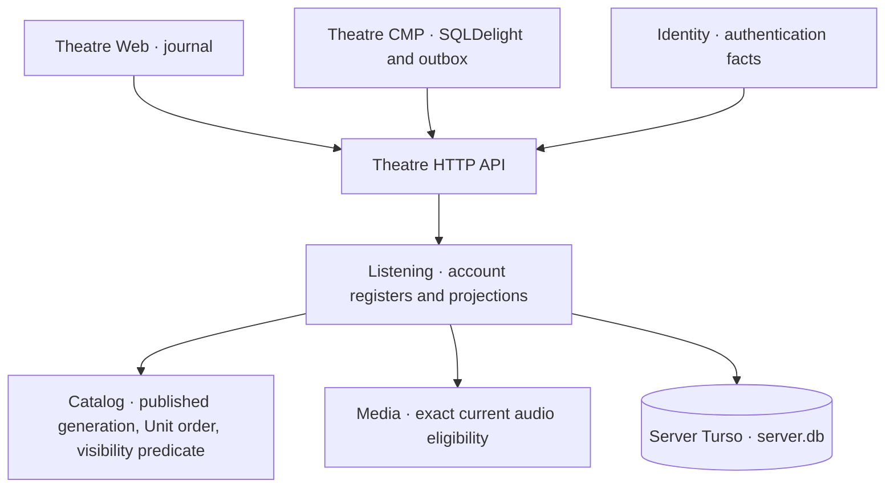

# Listener Library projection — accepted design

**Status: accepted design, not implemented.** The owner accepted the decisions in
[ADR 0057](../decisions/0057-listener-library-work-projection.md) on 2026-11-03 (reviewed against
`develop@1b8864d6`). Current behavior is still the 1.2.0 part of
[Library v1](../../services/cantos-server/contracts/theatre/library/v1/README.md), whose 1.3.0
definitions and fixtures now specify the representations below. Each slice of the
[Library handoff](../work-plan/listener-library-progress-handoff.md#next-delivery-work-level-library)
lands with its own evidence. The draft model `cantos.listening.library-projection`
([inventory](../../services/cantos-server/behavior/listening/library_projection.md)) encodes the
accepted rules, so their differences from today's code are executable.

## Ownership

| Owner | Decides | Never |
| --- | --- | --- |
| Listening (`contexts/listening`) | Saved, progress, history, bookmarks, receipts, page/cursor shape, the Work next action | Reads Catalog/Media tables except through their facades |
| Catalog (`contexts/catalog`) | Published Work metadata generation, Unit membership and `position`, Work/Unit visibility predicate | Knows account registers |
| Media (`contexts/media`) | Whether an exact release is currently public and playable; release presentation | Decides Library membership |
| Identity | Authentication/security facts only | Stores Library data |
| Web/CMP | Cache, pending intents, account/session fencing | Decide accepted account state or access |

These are modules of one Server process. No new service, crate or cache is needed for this
delivery. Keep the existing facades (`catalog::library_visibility`, `catalog::public_work`, the
`media::library_*` functions) as the only cross-context reads.

## Verified current behavior

Source-inspected at [`1b8864d6`](https://github.com/loveoverflowcom/cantos/tree/1b8864d6a972b2f7c7dca84de85cc8e489d7b103);
nothing below was executed in this review.

| Fact | Source | Consequence |
| --- | --- | --- |
| A new Save is admitted when the Work's active metadata generation is public; audio is not required | [`listening/turso.rs` L613–L623](https://github.com/loveoverflowcom/cantos/blob/1b8864d6a972b2f7c7dca84de85cc8e489d7b103/services/cantos-server/src/contexts/listening/turso.rs#L613-L623) → `catalog::public_work` | Correct per ADR 0054 |
| Saved `presentation=1` comes from one current **audio** representative per Work | [`media/turso/listener.rs` L777–L794](https://github.com/loveoverflowcom/cantos/blob/1b8864d6a972b2f7c7dca84de85cc8e489d7b103/services/cantos-server/src/contexts/media/turso/listener.rs#L777-L794) | A saved metadata-only Work is shown with `presentation:null` (inferred from the two paths; not reproduced) |
| Library item hydration calls `public_release` once per row (≤ 50) | [`media/turso/listener.rs` L757–L775](https://github.com/loveoverflowcom/cantos/blob/1b8864d6a972b2f7c7dca84de85cc8e489d7b103/services/cantos-server/src/contexts/media/turso/listener.rs#L757-L775) | N+1 statements per page; S11 measurement is still open |
| Discovery already serves one generation representation (`MetadataWorkSummary`, nullable `playback`) | [Discovery v1](../../services/cantos-server/contracts/theatre/discovery/v1/README.md#metadata-reads) | Saved and Discovery use two different Work card sources |
| Continue takes the newest register per Work, then drops it when completed | [`listening/turso.rs` L825–L834](https://github.com/loveoverflowcom/cantos/blob/1b8864d6a972b2f7c7dca84de85cc8e489d7b103/services/cantos-server/src/contexts/listening/turso.rs#L825-L834); test [`latest_completed_release_suppresses_older_unfinished_work_…`](https://github.com/loveoverflowcom/cantos/blob/1b8864d6a972b2f7c7dca84de85cc8e489d7b103/services/cantos-server/src/theatre_library_http_tests.rs#L397) | Finishing chapter 12 removes the novel from Continue |
| Library visibility is public-only, Work and anchor Unit, before keyset/LIMIT | [`library_visibility.rs`](https://github.com/loveoverflowcom/cantos/blob/1b8864d6a972b2f7c7dca84de85cc8e489d7b103/services/cantos-server/src/contexts/catalog/turso/library_visibility.rs) | Shared/restricted Works never enter Library |
| Web ignores playback observations of shared tracks | [`web/src/live/runtime.rs` L665](https://github.com/loveoverflowcom/cantos/blob/1b8864d6a972b2f7c7dca84de85cc8e489d7b103/apps/cantos-theatre/web/src/live/runtime.rs#L665) | Shared listening writes no Library state |
| Clear history removes history rows only | [Library v1 § Playback, completion, history and clear](../../services/cantos-server/contracts/theatre/library/v1/README.md#playback-completion-history-and-clear) | After “Xóa lịch sử”, Continue still lists the same Works; D-L08 removes the use case |
| Unit order is the generation entry `position` (1–1000, PK `work_id, generation, position`) | [`catalog_metadata_publications.sql`](https://github.com/loveoverflowcom/cantos/blob/1b8864d6a972b2f7c7dca84de85cc8e489d7b103/services/cantos-server/src/platform/turso/catalog_metadata_publications.sql#L30-L42) | “Next chapter” is an index probe, not a list load |

## Proposed projection

### Saved (D-L02)

Row membership is unchanged: Saved register `saved=1` and the Work-only visibility predicate,
applied before keyset/LIMIT. The presentation becomes:

- `work`: the Work card of the **active published metadata generation**, from the same Catalog
  facade that serves Discovery `/works/{work}` (title, kind, language, cover, visible Unit count,
  generation). One consumer representation per client for a Work card.
- `listen`: `playable` when at least one visible Unit of that generation has a current exact
  audio association, otherwise `no_audio_yet`. Media owns the predicate.

A shown row is never `null`; a Work that stops being visible simply leaves the page while the
register stays. One batched statement over the page's Work IDs (`json_each`) replaces the
per-row release hydration.

### Continue (D-L03, D-L04)

The anchor stays the newest register per Work (current window), **without** the completion
filter. A pure function derives one closed action:

| Anchor | Condition | Action (`next.kind` on the wire) | In Continue |
| --- | --- | --- | --- |
| unfinished | its exact release is current | `resume_exact` (audio, position) | yes |
| unfinished | another release is current for the Unit | `release_replaced` (stored audio, current publication) | yes, explicit choice only |
| unfinished | no current audio for the Unit | `audio_unavailable` | yes, as a state |
| completed | the immediately following visible Unit has current audio | `start_next` (Unit, publication, title, ordinal) | yes |
| completed | the following visible Unit has no audio yet | `waiting_audio` | no |
| completed | no following visible Unit | `caught_up` | no |
| any | anchor Unit or Work not visible | — | no, never an older-chapter fallback |

Only the four Continue actions are wire values; `waiting_audio`, `caught_up` and hidden are
outcomes of the pure function that keep the Work off the page. “Following” is the smallest `position` greater than the anchor Unit's position in the **active**
generation among visible Units (stored positions may have gaps; S10 makes outward ordinals consecutive). There is no skip over a
chapter without audio. Order stays the anchor's `listener_order`, so completing a chapter keeps
the Work at the top. `waiting_audio`/`caught_up` reuse the same function for Saved/Recent badges
later; they are not stored.

The membership predicate becomes `completion='in_progress' OR EXISTS(following visible Unit
with current audio)` and is applied before keyset/LIMIT. The page then hydrates `next` for at
most `limit` rows in one batched lookup. A Work can re-enter Continue above a frozen cursor
frontier only on refresh, as the existing frontier rule already states.

### Completion (D-L05)

Clients send `mark_completed` when the listener chooses it or when the engine acknowledges the
natural end of the current account/session/source at the exact duration. A checkpoint or seek
to the end remains a position, never completion. The Library v1 completion sentence now says
so; Web and CMP adopt it in L04/L05. Auto-next playback is not part of this delivery.

### Recent history without clear (D-L08)

History keeps the latest confirmed start per Work and engine-session de-duplication. The
clear-history use case is removed: Web/CMP drop the action in L04/L05, and L06 removes
`POST /library/history/clear`, `HistoryClear`, `history_epoch_conflict` and the epoch fields of
playback starts, history pages and cursors in the same delivery that updates every client.
Registered migrations are not edited; a constant epoch column may stay or be dropped by an
appended migration.

## API delta

| Route | Library 1.3.0 definition | Notes |
| --- | --- | --- |
| `GET /library/saved?presentation=2` | `SavedWorkPage` of `{ saved, work: WorkCard, listen: ListenState }` | `work` required, non-null |
| `GET /library/continue?presentation=2` | `ContinueWorkPage` of `{ work: WorkCard, anchor: ProgressRecord, next: NextAction }` | `next.kind` decides which nullable members are present |
| `GET /library/history` | unchanged until L06 removes its epoch | badges may reuse the next-action function later |

`WorkCard` mirrors Discovery's Work fields that a card needs: `work_id`, `kind`, `title`,
`language`, `unit_count`, nullable `cover`. `NextAction` is one closed object:

| `kind` | `unit_id`, `unit_title`, `ordinal` | `publication_id`, `duration_ms` |
| --- | --- | --- |
| `resume_exact` | the anchor Unit | the anchor's exact release (position is `anchor.position_ms`) |
| `release_replaced` | the anchor Unit | the current replacement, offered only by explicit choice |
| `audio_unavailable` | the anchor Unit | `null` |
| `start_next` | the immediately following visible Unit | its current release, started at zero |

The schema expresses the per-kind rules with `allOf`; the CMP wire generator and its subset
validator ignore `allOf`, so the Kotlin consumer re-checks them when it maps the wire value.

`presentation=2` is additive, binds the cursor like `presentation=1`, ships with strict JSON
Schema, fixtures and Server/Web/CMP decoders, and is removed together with the superseded lanes
once both clients have adopted it (ADR 0055). No new mutation route and no Library-home
aggregate endpoint: the three sections stay independent page reads (parallel, independently
retried and cached). Reconsider an aggregate only from measured CMP cold-start latency.

## Pure core and tests

- `listening::domain::projection::work_next_action(anchor, view) -> NextAction`, where `view` is
  the bounded fact set supplied by Catalog/Media (anchor visibility, anchor current release,
  following visible Unit and its current release). No database or HTTP inside.
- Native unit/property tests reuse the model's named-run IDs where the meaning matches
  (`cantos.listening.library-projection.run.*`); a pure-core observer needs a reviewed protocol change.
- File-backed Turso tests: metadata-only saved Work, completed chapter → next, caught up,
  waiting for audio, replaced release, hidden anchor, new chapter re-entry, cursor walk across a
  re-entry, account isolation; then HTTP/contract fixtures and both clients' strict decoders.

## Performance plan

Follow the [Turso read-performance method](../../.agents/skills/cantos-engineering/references/turso-read-performance.md)
under #384: measure first with a [localhost dataset profile](../deployment/localhost-datasets.md).

| Read | Cost after the change | Trigger for more |
| --- | --- | --- |
| Saved page | one keyset scan on `listener_saved_recent` + one batched metadata/audio statement | none expected |
| Continue page | window over the account's progress rows + ≤ `limit` index probes on the generation PK | p95 over the agreed budget with ≥ 5 000 progress rows |
| Next-action hydration | one batched statement for the page | — |

If the Continue window is measured too slow, add a derived `listener_work_activity(listener_id,
work_id, anchor_publication_id, listener_order)` row written in the same unit as each progress
mutation. It stores pointers, not positions, so it is an index of the existing registers, not a
second progress store. Caches (ArcSwap/Quick Cache) come only after SQL/index work, per #384.

## Access extension (D-L09, later)

Replace the static predicate with a viewer-aware one owned by Catalog (`cantos.catalog.viewer-access`)
once the #634 shared projection exists. Keep four separate questions: may see metadata, may save,
may record progress, may fetch media. Filter before count/sort/page; the cursor already binds
`visibility_scope`. Revocation removes rows on the next read and clients purge cached projections;
a retained register never becomes permission.

## Synchronization acceptance

Keep operation IDs, revisions, receipts, the Web journal, the CMP outbox and account/session
fencing ([consumer rules](../work-plan/listener-library-progress-handoff.md#required-webcmp-consumer-behavior)).
Required cross-client cases:

| Case | Expected |
| --- | --- |
| Save on Web, open CMP | Same Saved row and revision |
| Pause on CMP, open Web | Same exact release and position |
| Rewind after a later checkpoint | Explicit seek wins; a delayed old checkpoint is `keep_server` |
| Lost Save/Unsave response, then retry | Same receipt; no flip |
| Duplicate engine start after a retry | Same receipt; history keeps one entry per Work, not reordered |
| Finish a chapter on CMP, open Web | Continue shows the next chapter |
| Sign out A, sign in B | No A rows rendered or submitted as B |

## Extension paths

| Later need | Shape that MVP keeps open |
| --- | --- |
| Named collections | New `collections` and `collection_items(work)` resources on the same operation envelope; Saved stays its own register (optionally exposed later as a read-only built-in list) |
| Per-session history, play counts | `listening_sessions` from engine-session acknowledgements, deduplicated by engine session, with a retention policy decided first; never one row per checkpoint |
| Dismiss from Continue | Per-Work `continue_dismissed_order`; a Work shows again when its anchor order exceeds it |
| Listening-data export/deletion | An account-level flow designed with receipt/tombstone/session retention horizons; no per-section clear (D-L08) |
| Downloads, new-chapter notifications | Own registers and lifecycles; never derived from Saved |
| Work completion | Needs an owner-declared series status in Catalog first |
