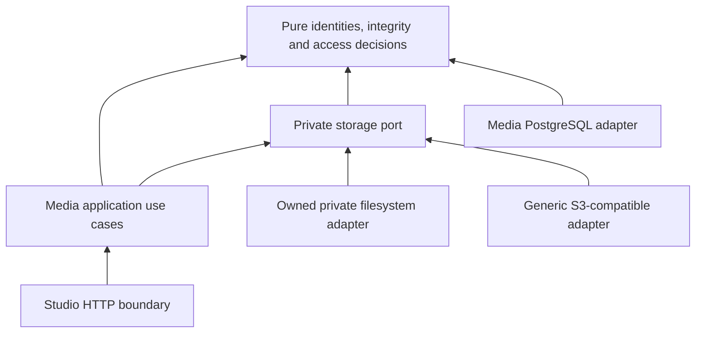

# Private object storage and exact content reads

This document defines the implementation boundary for provider-independent private storage.
The audit baseline is the existing development filesystem intake. The S3 adapter, target
registry and private audio reads described below are an implementation plan until the PR's
code and separate evidence record establish them. No live provider or publication acceptance
is implied. See [ADR 0022](../decisions/0022-provider-independent-private-storage.md).

## Content authorities

Storage answers where exact bytes can be found; it does not decide which content revision,
submission, approval or publication is authoritative.

| Content | Authority and current persistence | Retrieval boundary |
| --- | --- | --- |
| Work and content-unit metadata, ordering and owner | Catalog; existing PostgreSQL aggregates and history | Existing authorized Catalog application queries and cursor contracts |
| Canonical manuscript text | Catalog `ContentRevision`; bounded `ManuscriptText` (65,536 UTF-8 bytes) in PostgreSQL | Exact authorized unit/revision lookup; a head is a separate explicit request |
| Original manuscript file and import receipt | Ingestion; bounded immutable original bytes and checksum in PostgreSQL | Ingestion owner read; linked source access remains an independently authorized operation |
| Exact Script IR export | Editorial; immutable export bytes, `sir-c1` content and `sir-e1` export digests in PostgreSQL | Editorial exact script/revision read, authorized afresh |
| Verified audio rendition and admission receipt | Media; immutable PostgreSQL metadata and private filesystem bytes at the audit baseline | Media owner authorization, then exact asset location and byte verification |
| Published text/audio projection | Publication, when implemented | Only an approved immutable manifest and separate listener authorization |

Keep the existing bounded text, source and Script IR records in PostgreSQL. Moving them into
object storage for symmetry would add I/O and migration risk without an actual large-artifact
consumer. A later large original/export may gain a private immutable location reference through
its owning context; it must not duplicate Catalog, Ingestion or Editorial authority. Neither
the current Catalog navigation links nor a caller-declared checksum replace a pinned revision.

See [Content Identity](../decisions/0019-content-identity.md),
[API contexts](api-contexts.md) and [Script IR](script-ir.md).

## Dependency boundary

Arrows denote dependencies, not delivery flow. The application coordinates authoritative
context facts, authorization, storage effects and metadata commits. Pure values and decisions
contain no endpoint, URL, bucket, credential, SDK, HTTP response or PostgreSQL client. Provider
selection and credentials belong to the composition root and adapter. Keep the port in the
existing Media boundary because private audio intake and preview are its concrete consumers;
introduce no crate, service or generic repository framework.

The narrow capability set is immutable conditional creation, byte verification and exact
bounded reads. Adapter `HEAD`/`GET` and scoped presigning support those consumers; they are not
general-purpose domain repositories. There is no listing, deletion, ACL update, bucket-policy
update, publication promotion, multipart upload or migration engine in this boundary. Direct
temporary uploads require their own admission/finalize consumer and are deferred.

## Immutable location and integrity

1. Internal object keys come from admitted content digests or server-minted immutable identities,
   never filenames, titles, request paths or an arbitrary client object key. Fallible private
   types reject invalid target IDs, keys, digest encodings and lengths on every restore path.
2. Actual bytes must match the expected SHA-256 and exact length before acceptance. An object
   store's successful `PUT`, caller metadata or S3 ETag is insufficient proof. Preserve the
   existing audio-format inspection; a storage proof alone does not admit an audio rendition.
3. An accepted object's bytes and receipt stay immutable. Equal retries reconcile the original
   accepted result; a different payload under the same identity is a typed conflict/corruption
   outcome and must never replace it. Rejected, partial or ambiguous objects are private.
4. Metadata commits follow object I/O and reauthorization. No PostgreSQL transaction stays open
   during upload, hash readback or lengthy inspection. A failed transaction may leave a private
   orphan but no accepted receipt. Rollback never deletes a shared content-addressed object.
5. Persist an opaque stable storage target ID with each admitted asset's private location.
   Public content identity remains the existing Work/Unit/ContentRevision/Script/Rendition ID
   and digest; it contains no provider name, bucket, key or URL.
6. Historic reads resolve the persisted target, even when a different target receives new
   writes. A missing target is unavailable and never falls back to the active write target.
   Changing a target ID's endpoint, bucket or filesystem root can misroute all its historical
   records and therefore requires a controlled migration, not ordinary provider switching.

Legacy filesystem receipts and rendition snapshots have their own immutable digests. Preserve
them rather than rewriting their serialized bodies or checksums to add storage fields. Additive
Media location metadata must map those records to an explicit stable legacy filesystem target;
it cannot infer their location from the current write default. Retain the existing filesystem
key layout so accepted historical bytes remain readable.

## Adapter contract and failure behavior

The filesystem implementation retains owned 0700 directories, pinned directory descriptors,
no symlink traversal, server-derived digest basenames, read-only 0400 files, synchronized staged
bytes and atomic non-overwriting publication. Exact verification reopens and hashes the bounded
object and checks the selected inode has not changed. Range reads seek and stream bounded
chunks; they do not buffer an entire object to serve a small interval. Unix filesystem support
does not imply a supported native adapter on every operating system.

The generic S3 implementation uses a configured HTTPS endpoint, region, bucket and explicit
path-style or virtual-hosted addressing. Credentials are resolved from named secret inputs.
Transport has bounded connection/request timeouts, no automatic redirect to a different host,
no implicit environment proxy, and no response decompression that could change audio bytes.
The initial scope is bounded single-object operations within existing intake limits.

Conditional creation requires a declared compatible `If-None-Match: *` operation. A provider
without that capability is ineligible for writes. Never emulate it by `HEAD` followed by an
unconditional `PUT`: another writer can win between the two. A `412` existing-object response
requires exact byte verification; a `409` conditional conflict or transport timeout can be
ambiguous, so recovery resolves the immutable key and verifies bytes before a safe conditional
retry. No second metadata acceptance is inferred from an external success status.

Configuration declares required capabilities; declaration is an operator assertion, not a
live acceptance test. Startup validates the schema and required capability combination without
network writes. Runtime responses must still satisfy exact status, length and range contracts.
Unsupported operations, mismatches, missing objects, access denial, timeout, cancellation and
outage propagate through closed typed outcomes and sanitized HTTP errors. Never log a secret,
signed URL, internal object key, private root or provider response body.

## Configuration and provider switching

The intended explicit path is `CANTOS_STORAGE_CONFIG`, pointing at a non-secret TOML topology;
`services/cantos-api/config/storage.example.toml` will document the implemented schema.
Reject unknown fields, duplicate/inconsistent target declarations, missing active target,
invalid paths/endpoints, missing secret inputs and unavailable required capabilities. There is
no silent provider fallback. Keep the existing development filesystem setting compatible or
document the explicit transition when the parser lands; do not invent a production deployment
from the loopback-only development host.

An operator keeps all historical targets configured for reads while selecting one active
target for new writes. For example, after changing new writes from a Long Vân target to an R2
target, the earlier asset's location still names its Long Vân target. Configuration changes
neither copy nor migrate bytes. Credentials, session tokens, signed grants and live endpoint
values stay outside Git. External storage belongs to the service inventory as operator-managed
infrastructure; build, test and run never provision it. Follow
[ADR 0021](../decisions/0021-podman-service-runtime.md) for an explicitly authorized disposable
Podman test service. No Docker Compose or automatic Podman machine startup is introduced.

Future migration is a separate controlled process: **copy → verify actual bytes and SHA-256 →
register ready replica/location → controlled read switch → retention and rollback**. Retain
the old readable location until the retention decision permits removal. This PR needs only
the durable original location, not replica scheduling, cleanup or a migration engine.

## Authorized reads and delivery

Catalog and Editorial already expose exact Studio reads. Reuse their authorization and history
queries rather than copying tables or adding a second catalog. An exact content read resolves
the unit's parent Work, current access and the requested ContentRevision; an exact ScriptRef
resolves the referenced immutable Editorial revision/export digest. An absent historical
revision must never be replaced with the head. Content permission does not automatically grant
access to every script, source or rights record it references.

Private audio preview requires a current owner authorization for the exact admitted rendition,
then its persisted storage target/key, byte length, SHA-256 and versioned audio profile. An
accepted structural inspection is not rights clearance, named listening, publication approval
or a listener entitlement. Producer upload credentials and Studio cookies remain distinct.

Binary delivery is separate from JSON/MessagePack metadata. A protected local stream is suitable
for development. A compatible S3 provider may return a short-lived scoped `GET` grant after
authorization; clients refresh through the authorized backend instead of retaining a permanent
private-bucket URL. A grant is a bearer secret that may reveal its scoped endpoint/key to the
authorized holder; it is never a public content identity, persisted receipt or logged value.
Revocation blocks new grants, while already issued grants remain usable until expiry according
to provider policy. Proxy streaming remains available where the direct-grant capability is
absent; an absent conditional-write capability has no unsafe fallback.

Full delivery uses `200`; a satisfiable single byte range uses `206` with exact `Content-Range`
and interval `Content-Length`; an unsatisfiable range uses `416` with
`Content-Range: bytes */<length>`. Pure range normalization rejects malformed input and checks
overflow. Document the supported single-range/conditional request subset in the implemented
read contract. Audio is not compressed in transit. Use the immutable SHA-256 as the API
checksum/ETag identity, never substitute an S3 ETag for it. Cancellation releases bounded
stream resources; admission's blocking inspection permit remains owned until work actually
finishes, as in the current intake.

Theatre's router remains unavailable. Publication manifest authority and listener access are
dependencies of [#11](https://github.com/loveoverflowcom/cantos/issues/11) and
[#12](https://github.com/loveoverflowcom/cantos/issues/12), respectively. A future versioned
publication read projection may expose approved asset IDs/checksums and optional approved
text; it must not expose private Script IR, source/rights records, storage target IDs or keys.
Do not manufacture a publication, public object or entitlement to exercise it. No Theatre
request may reuse a Studio cookie/handler or invoke production.

## Provider capability and security matrix

| Capability | Filesystem development adapter | Generic S3-compatible target | Provider acceptance requirement |
| --- | --- | --- | --- |
| Immutable create | Atomic non-overwriting link of synchronized bytes | Conditional single `PUT`; absent declaration fails closed | Conflicting and concurrent writes preserve original bytes; no ignored precondition |
| Integrity | Exact readback SHA-256, length and inode checks | Exact bounded `GET` readback SHA-256 and length | Corruption, truncation and metadata/body disagreement rejected |
| Exact lookup | Persisted target and validated digest basename | Persisted target and validated internal key | Changing active write target leaves historical reads on original target |
| Byte ranges | Protected seek/stream | Exact single-range `GET` or scoped direct grant | First/middle/final/suffix ranges; `206`, headers and `416` behavior |
| Temporary grant | Protected Studio API read, no presigned URL | Optional declared compatible presigned `GET` | Unauthenticated and expired requests denied; grant refresh and expiry observed |
| Privacy | Owned private root; same-process static serving disabled | Operator-managed private bucket; least-privilege credentials | Anonymous GET/list denied; logs and error bodies contain no secrets |
| One-bucket intake | One private root | One wholly private bucket is sufficient | No public ACL, CDN origin or policy widening on private intake |
| Publication delivery | Not implemented | Not implied by S3 compatibility or private intake | Separate approved-manifest/identity/policy/CDN boundary after #11/#12 |

Long Vân, R2 and B2 are configuration targets, not domain variants. Their claimed compatibility
does not prove identical conditional-write, presigning, Range, CORS or privacy behavior. No
vendor is live-accepted by this document. If a one-bucket plan cannot isolate future publication
delivery from private objects using reviewed policy, it cannot host that publication model;
retain private-only intake or choose separate delivery storage. Never loosen private access to
compensate for a bucket limit.

## Verification and deferred acceptance

Keep an independent L1–L5 evidence ledger in the PR/evidence record. L1 covers authority and
inward dependencies; L2/L3 cover immutable identities, integrity/access decisions and ranges
without infrastructure; L4 exercises production orchestration with named fake storage or
controlled S3 responses; L5 covers disposable PostgreSQL, real HTTP/auth and actual filesystem
boundaries. Mocks do not prove real provider durability, privacy, throughput or streaming.

Provider acceptance requires explicit operator authorization and credentials, plus a disposable
owned key namespace. Record provider/account class, endpoint configuration, fixture digest,
commands, response observations and cleanup/retention ownership outside Git. Check `HEAD`,
full `GET`, conditional upload/replay/conflict, actual-byte integrity, Range `206`/`416`,
presigned expiry/scoping, CORS for the intended browser origin, connection concurrency,
cancellation/timeouts, latency and throughput. A later CDN requires its own delivery-path
checks. Every unrun item is `NOT_RUN`; a provider declaration or mocked response is not a pass.
