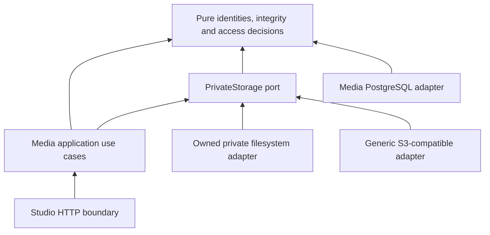

# Private object storage and exact content reads

Media implements provider-independent private storage with filesystem and generic S3-compatible
adapters, durable target selection and owner-authorized audio reads. This document describes
the code boundary; the separate [evidence record](../evidence/provider-independent-storage.md)
owns commands and actual results. No live-provider, publication or production-streaming
acceptance is implied. See [ADR 0037](../decisions/0037-provider-independent-private-storage.md)
and [Private content reads v1](../../packages/contracts/private-content-reads-v1.md).

## Content authorities

Storage answers where exact bytes can be found; it does not decide which revision, submission,
approval or publication is authoritative.

| Content | Authority and current persistence | Retrieval boundary |
| --- | --- | --- |
| Work/content-unit metadata, ordering and owner | Catalog; existing PostgreSQL aggregates/history | Existing authorized Catalog queries and cursor contracts |
| Canonical manuscript text | Catalog `ContentRevision`; bounded `ManuscriptText` (65,536 UTF-8 bytes) in PostgreSQL | Exact authorized unit/revision lookup; a head is a separate request |
| Original manuscript file and import receipt | Ingestion; bounded immutable original bytes and checksum in PostgreSQL | Independently authorized Ingestion owner read |
| Exact Script IR export | Editorial; immutable export bytes, `sir-c1` content and `sir-e1` export digests in PostgreSQL | Exact authorized script/revision read |
| Verified audio rendition and admission receipt | Media; immutable PostgreSQL metadata and bytes at the recorded private filesystem/S3 target | Media owner authorization, exact location and byte verification |
| Private Work cover and selection history | Media sidecar; immutable PNG/JPEG facts and recorded target/key/SHA/length, Catalog-owned Work revision CAS | Current active owner, exact accepted asset and shared verified private read; no public image projection |
| Published text/audio projection | Publication core; real delivery acceptance gated | Approved immutable manifest plus separate listener authorization; private storage grants no release access |

Bounded text, sources and Script IR stay in PostgreSQL. A later large original/export may gain
a private revision-bound location through its owning context; it must not duplicate Catalog,
Ingestion or Editorial authority. Catalog navigation links and caller-declared checksums do
not replace pinned revisions. See [Content Identity](../decisions/0019-content-identity.md),
[API contexts](api-contexts.md) and [Script IR](script-ir.md).

## Dependency boundary



Arrows denote dependencies. Domain values contain no endpoint, URL, bucket, credential, SDK,
HTTP response or PostgreSQL client. Media owns this port because private audio intake and
preview are its concrete consumers; there is no new crate, service or generic repository.

The concrete `Store` and aggregate `StoreError` are owned by `src/application.rs`. This handle
joins the PostgreSQL pool and Media's registry for owning application use cases.
`platform/postgres` retains compatibility reexports and connection/session plumbing, with no
Media import. The Media read application facade owns authorization, storage effects and the
authorization recheck; HTTP never selects providers or arbitrary internal locations.

`PrivateStorage` exposes `put_if_absent`, `verify`, `open_verified` and optional
`temporary_read`. S3 verification hashes an actual bounded `GET` body. There is no `HEAD`
port operation or provider `HEAD` request in this adapter. Listing, deletion, ACL/bucket-policy
updates, publication promotion, direct temporary uploads, multipart and migration orchestration
have no implementation in this boundary.

Private writes consume the closed `VerifiedPayload` alternatives `VerifiedAudio` and
`VerifiedImage`, each constructible only by its actual inspector. MIME, digest, length and
bytes come from that witness: Ogg/Opus audio or PNG/JPEG image, never a caller-selected type.
Images retain their separate 8 MiB encoded/64 MiB decoded admission policy; the shared
32 MiB object envelope does not widen that policy. `persist_image` reuses the same registry,
conditional writes, filesystem descriptors, S3 transport and bounded lanes. The historical
S3 `private/audio/` prefix (`PRIVATE_OBJECT_NAMESPACE` in the adapter, pinned by a unit test)
remains an internal shared namespace so old locations do not move.
Owner image preview exposes neither temporary grants nor ranges in this MVP.

For image PUT, owner-backed `Bytes` retains `Arc<VerifiedImage>` through every transport
clone; a separate owner survives actual readback. Cancelling the caller cannot release the
image admission lane while a surviving encoded transport body still owns it. This is bounded
ownership, not a hard decoder/process CPU or total-RSS guarantee. See the
[artwork contract](../../packages/contracts/artwork-v1.md) and
[current evidence](../evidence/private-work-artwork.md).

## Immutable location and integrity

- `ObjectKey` admits exactly 64 lowercase SHA-256 hex characters. New writes derive it from
  actual bytes, never a filename, title or client key. S3 adds `private/audio/`; filesystem
  retains `objects/<digest>`. `ObjectIntegrity` checks canonical SHA-256 and 1 byte through 32 MiB;
  `PrivateObjectRef` binds the exact target/key/integrity and requires key == digest.
- A successful PUT, caller metadata or S3 ETag cannot prove integrity. Actual readback SHA-256
  and length must match; existing audio-format inspection is still required for admission.
- Accepted bytes, receipts and rendition snapshots remain immutable. Equal retries reconcile
  the original result; conflicting bytes never replace it. Rejected, partial and ambiguous
  objects remain private.
- Inspection and object I/O finish outside metadata transactions. Final acceptance rechecks
  authorization and pinned facts. Transaction failure may leave a private orphan and no
  receipt. Rollback never deletes a shared content-addressed object.
- New writes use the active target; historical reads resolve the recorded target. Missing
  targets are unavailable, with no default fallback. Target IDs are private location metadata,
  separate from public Work/Unit/ContentRevision/Script/Rendition identities.

Migration `0015_media_storage_targets.sql` adds `storage_target_id` outside immutable snapshot
bodies, on `audio_intake_receipts` and `audio_renditions`. Existing records receive
`legacy-filesystem`; new writes supply their target explicitly. Snapshot bytes/digests and
legacy basenames remain unchanged. Keep that target bound to the original root after switching
new writes. The default permits the preceding filesystem-only version to write compatible
local rows, but that older version cannot read new S3 locations; rollback after remote writes
needs compatible readers.

## Adapter behavior

Filesystem retains owned 0700 directories, pinned directory descriptors, no symlink traversal,
0400 files, synchronized staging and atomic non-overwriting links. Delivery hashes the bounded
object, verifies the named inode and retains the same open handle while seeking/streaming.
It never verifies, closes and reopens a mutable name. Chunks are at most 16 KiB; a small range
still requires full-object hashing, but no full-object memory buffer. Native filesystem
support remains Unix-only.

S3 uses configurable HTTPS, region, bucket and explicit path-style or virtual-hosted addressing.
The adapter receives credentials from composition, with connection/request deadlines, no
redirects, no implicit environment proxy and no response decompression. Its scope is bounded
single-object operations within the existing audio envelope.

The active S3 write target must declare `conditional_put = true`. PUT uses
`If-None-Match: *`; `200` or duplicate `412` is followed by full byte verification. A `409`
conflict or timeout returns a typed failure and may leave a private object; there is no automatic
retry loop. The existing durable intent/submission remains the reconciliation scope. A caller
can repeat the same eligible intent/payload and conditional key; bytes must verify before a
receipt commits. There is no unsafe HEAD-then-unconditional-PUT emulation.

For API delivery, S3 first hashes a full GET, then pins the delivered request by usable version
ID or strong opaque ETag with `If-Match`. The response must confirm that pin. Without either
validator it fails unavailable. Full delivered bodies are checked again at stream end.
A provider ETag is a transport validator, never the accepted checksum. Range delivery requires
declared support and exact `206`, length and Content-Range; it has no unsafe fallback.

Persisted identity is the original target, content-addressed key, accepted SHA-256 and length.
The provider version observed at admission is not retained in PostgreSQL. Each read verifies
current bytes before selecting its version/ETag pin; different bytes are rejected, while
recreated identical bytes remain eligible. Retrieving a noncurrent historical S3 version after
deletion of the current object requires a separate retained-version capability. Per-read pinning
does not establish that capability or provider retention.

## Checked configuration and switching

`CANTOS_STORAGE_CONFIG` is an absolute path to a non-secret TOML topology. The
[example](../../services/cantos-server/config/storage.example.toml) and
[API guide](../../services/cantos-server/README.md#private-audio-storage) describe setup.
The existing `CANTOS_AUDIO_ROOT` setting selects `legacy-filesystem`. Setting both is a
startup error. Leaving both unset preserves existing editorial/static behavior and makes
private audio storage unavailable. Either storage setting disables same-process static serving;
the loopback/development-session host is not a production isolation policy.

| Configuration | Checked behavior |
| --- | --- |
| Document | `version = 1`; at most 65,536 bytes and 16 targets; unknown fields rejected |
| Target ID | 1–63 lowercase ASCII characters; starts with a letter, then letters/digits/hyphens; no trailing hyphen |
| Topology | Nonempty targets; active target present; no fallback after errors |
| Filesystem | Absolute private root plus owned-directory/traversal checks |
| S3 origin | HTTPS only; no userinfo/query/fragment/path; virtual-hosted addressing rejects IP endpoints |
| Timeouts | Connect 1–60,000 ms; request 1–300,000 ms; connect <= request |
| Secrets | Distinct uppercase environment-variable names for access/secret and optional session token; required values for every configured target resolved at startup |
| Capabilities | Active S3 target requires conditional PUT; presigned reads also require range reads |

Filesystem example:

```toml
version = 1
[storage]
active_write_target = "legacy-filesystem"
[storage.targets.legacy-filesystem]
driver = "filesystem"
private_root = "/var/lib/cantos/private"
```

New S3 writes with historical local reads retained:

```toml
version = 1
[storage]
active_write_target = "remote-private"
[storage.targets.legacy-filesystem]
driver = "filesystem"
private_root = "/var/lib/cantos/private" # keep the original location
[storage.targets.remote-private]
driver = "s3"
endpoint = "https://storage.example.invalid"
region = "auto"
private_bucket = "private-audio"
force_path_style = true
access_key_env = "CANTOS_S3_ACCESS_KEY_ID"
secret_key_env = "CANTOS_S3_SECRET_ACCESS_KEY"
# session_token_env = "CANTOS_S3_SESSION_TOKEN"
connect_timeout_ms = 3000
request_timeout_ms = 10000
conditional_put = true
range_reads = true
presigned_reads = false
```

These examples declare topology, not acceptance or provisioning. Secret values stay outside Git
in operator-managed injection. Keep all historical targets configured for reads when changing
the write target. Changing an existing target's endpoint, bucket or root can misroute its old
records and requires a controlled migration. Configuration alone copies no bytes.

Future migration remains **copy → verify actual bytes/hash → register ready replica/location →
controlled read switch → retention/rollback**. This slice stores original locations only.
No replica engine or orphan collector is implemented. External providers are inventory-only;
build/test/run never provision them. Disposable Podman acceptance requires explicit operator
authorization under [ADR 0021](../decisions/0021-podman-service-runtime.md).

## Authorized content and audio reads

Catalog, Editorial and Ingestion exact readers are reused. A ContentRevision read resolves
the unit's parent Work, current access and exact revision. A ScriptRef read resolves its exact
Editorial revision/export digest. No missing historical revision is replaced by a head, and
access to Content does not automatically grant access to every source, script or rights record.

Under `/api/v1/studio`, Media adds:

| Method/path | Authorized identity |
| --- | --- |
| GET/HEAD `/scripts/{script}/audio-intents/{intent}/bytes` | Immutable receipt of this exact owner intent |
| GET/HEAD `/content-units/{unit}/audio-submissions/{submission}/renditions/{rendition}/bytes` | Exact admitted rendition and its submission/unit |
| GET `/scripts/{script}/audio-intents/{intent}/read-access` | Refreshable access to the same accepted object |
| GET `/content-units/{unit}/audio-submissions/{submission}/renditions/{rendition}/read-access` | Refreshable access to the explicit rendition |

Media resolves ownership/location before I/O, then rechecks the current session/owner and exact
location before returning a stream or grant. Producer upload credentials grant no preview access.
Accepted format inspection implies neither rights clearance, named listening nor publication.

Binary responses remain separate from JSON/MessagePack metadata. Full GET is `200`; a
satisfiable single closed/open/suffix range is `206` with exact interval length/Content-Range;
an unsatisfiable range is `416` with `bytes */<length>`. Malformed/multiple/overflow byte ranges
are `400`. Unknown units and mismatching If-Range use full delivery; HEAD ignores Range and
has no body. The [read contract](../../packages/contracts/private-content-reads-v1.md) owns
the supported conditional subset and safe error responses.

The API ETag is accepted SHA-256; responses are `audio/ogg`, uncompressed and `no-store`.
Streams enforce exact length, a 60-second wall-clock bound and four request lanes. Registry
operations separately have four lanes, retained through returned streams until completion/drop.
Cancellation drops the stream/transport; blocking filesystem work retains its own permit until
finished. Failures before headers produce typed HTTP errors; failures afterward abort the body
and cannot replace the sent status. No cancelled request deletes an object.

`/read-access` returns `303` to a 60-second scoped S3 GET grant only when capability is
declared and actual-byte verification yields a usable version ID. Otherwise it returns `303`
to protected API bytes. Refresh through this owner-authorized route. Grants are bearer secrets,
never persisted/logged or used as identity; they may reveal a scoped key to the authorized
holder. Revocation blocks new grants; issued grants may remain usable until expiry. Range,
CORS and actual expiry require provider acceptance.

Theatre remains unavailable until [#11](https://github.com/loveoverflowcom/cantos/issues/11)
supplies an approved immutable manifest and
[#12](https://github.com/loveoverflowcom/cantos/issues/12) supplies separate listener access.
The proposed publication read projection is documented but never constructed/served here.
Approved text is an explicit projection; private Script IR/source/rights and internal storage
locations do not cross it. Theatre cannot reuse Studio cookies/handlers or invoke production.

## Provider capability and security matrix

| Capability | Filesystem development | Generic S3-compatible | Acceptance obligation |
| --- | --- | --- | --- |
| Immutable create | Synchronized atomic non-overwriting link | Conditional PUT; absent capability rejects active writes | Concurrent/conflicting writes preserve bytes; preconditions are honored |
| Integrity | SHA-256/length/inode checks | Bounded full GET SHA-256/length | Corruption, truncation and metadata/body disagreement rejected |
| Historical lookup | Recorded target and digest basename | Recorded target and fixed private key prefix | Switching active writes leaves old reads on their original target |
| API read pin | Exact verified open inode | Version or strong opaque ETag; otherwise unavailable | Replacement races fail closed; ETag is not a checksum |
| Range | Protected seek/stream | Declared exact ranged GET | First/middle/final/suffix, `206`, headers and `416` |
| Temporary grant | Protected API only | Declared presign plus usable version ID; otherwise protected API | Version pin, scoping, refresh, anonymous/expired denial |
| Privacy | Owned private root; API-only development host | Operator-managed private bucket/least-privilege secrets | Anonymous GET/list denied; error/log redaction checked |
| One-bucket intake | One private root | One wholly private bucket suffices | No public ACL/CDN origin or policy widening on private intake |
| Publication | Separate release core; delivery gated | Not implied by private S3 intake | Separate manifest/identity/isolation/delivery acceptance under #11/#12/#170 |

Long Vân, R2 and B2 are configuration targets, not domain variants. This slice has no live
acceptance for any of them. The [Long Vân profile](../../services/cantos-server/config/storage.longvan.example.toml)
and the operator-run live-acceptance harness are recorded in the
[Long Vân evidence](../evidence/longvan-s3-acceptance.md); until that harness passes against the
real account, the profile is a declaration, not acceptance. A one-bucket plan that cannot isolate future publication policy
from private drafts cannot host that publication model; retain private-only intake or choose
separate delivery storage. Never loosen private access for a bucket limit.

## Verification and deferred acceptance

The independent [L1–L5 ledger](../evidence/provider-independent-storage.md) separates domain,
named fake-registry orchestration, controlled S3 HTTP boundaries, real PostgreSQL/HTTP and actual
filesystem evidence. Mocked responses establish no vendor durability, privacy or performance.

Live provider acceptance needs explicit operator authorization/credentials and disposable owned
keys. An ignored, operator-run test over this adapter (`live_private_bucket_acceptance`, never part
of a gate) produces the redacted ledger for a provider; its commands are in the
[Long Vân evidence](../evidence/longvan-s3-acceptance.md#operator-procedure). Record account/endpoint class, fixture digest, observations and retention/cleanup owner
outside Git. Check manual HEAD (a provider probe, not a port operation), full GET, conditional
upload/replay/conflict, actual bytes, Range `206`/`416`, version-pinned presign expiry/scoping,
CORS, connection concurrency, cancellation/timeouts, latency and throughput. A CDN needs its own
delivery-path acceptance. Every unrun item remains `NOT_RUN`; declarations and mocks are not
live passes.

## Shared HTTP mechanics, separate delivery authority

Owner audio preview now consumes `adapters/inbound/http/audio_transport.rs`, with the same private
application authorization/open/recheck ordering. It owns HTTP conditional/range responses and
pull-driven exact-length bodies, not storage scope or listener authority. The
[transport record](../evidence/playback-range-transport.md) separates its deterministic evidence
from a test-only Theatre publication fixture. No private target, `PrivateStorage`, Studio
preview or presigned URL is promoted or exposed to Theatre by sharing this helper. Publication
composition stays fail-closed until the [delivery decisions and live gates](../decisions/0038-publication-streaming-evidence-gates.md) are accepted.
