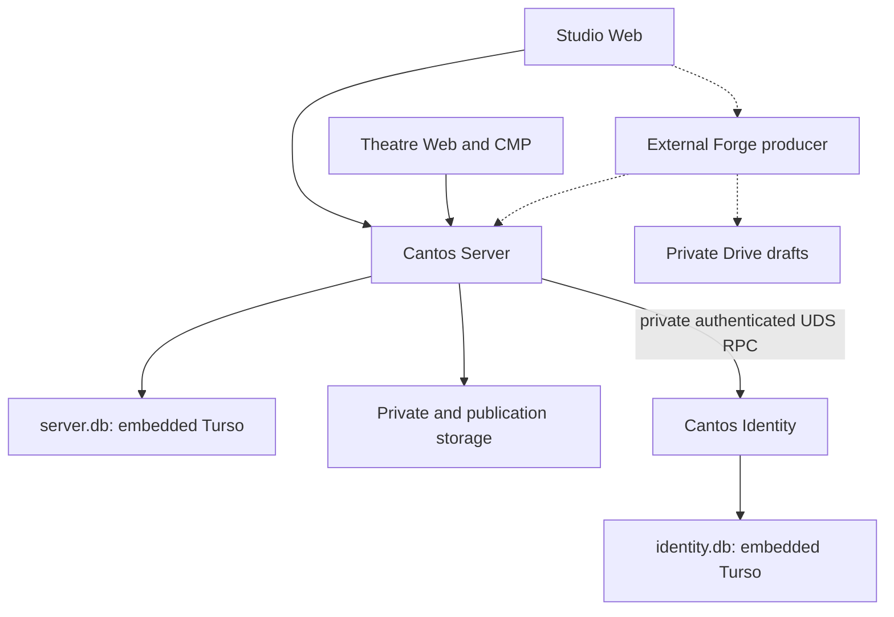

# Cantos architecture overview

The [native decision](native-turso-refactor.md), [Identity v1](../../services/cantos-server/contracts/auth/identity-auth/v1/README.md)
and [external-production ADR](../decisions/0018-external-audio-production.md) own current boundaries.
Read the [porting checkpoint](server-turso-porting.md#checkpoint-boundary) before running business flows.

## System boundaries

Solid edges describe implemented source boundaries, not full deployed/runtime acceptance.
The embedded owner, actors, native sessions and all Server-owned business adapters use Turso.
Migrations 12–23 implement the business ports; v24 adds public-cover disclosures. Immutable
placeholder versions 4–11 remain registered history, not unfinished implementation slots. Dashed Forge edges describe #203's planned
trusted invocation, provider/Drive execution and API handoff; local artifact/attempt/worker cores
exist, HTTP fails closed. Static Hosting/Pages, Functions and OCI hosting have independent owners.

## Ownership and invariants

Server is one modular Rust/Axum HTTP process for Studio/Theatre/Admin, with distinct route,
purpose, origin and authorization policy. Identity owns mailbox/password/security facts, never
Server sessions or business permissions. Each process exclusively owns its DB: no file sharing,
ATTACH/JOIN, competing owner or cross-DB transaction. Web uses cookie + CSRF/exact origin;
CMP/native uses opaque Bearer. Provider authentication is retired; Admin fails closed.

Pure typed domain decisions sit inside application use cases and context-owned persistence/
HTTP/storage adapters. Editorial/Ingestion/Adaptation retain immutable revisions and provenance;
Catalog/Content own Works/Units and revisions; Production owns instructions, rights and read grants;
Media/Publication own private admission, QC/approval and immutable release pointers; Listening
owns account-scoped Library/progress. Apps consume service-owned contracts through their own representations, never service crates
or each other's UI.

Object I/O is outside DB write units, followed by current authority/integrity rechecks. Private
bytes never imply publication. Playback never invokes generation. External producers own TTS,
mixing/encoding and costs; Forge is not required for login/serving. No new backend worker follows
from an old TTS/DBSP document.

## Current evidence and next work

[Readiness](native-persistence-readiness.md) separates implemented native persistence from
#333/#335 parity and HTTP/browser/device qualification. The #336 records retain source-bound
restore/Kani/isolation/footprint evidence and gaps; issue closure is not a fresh runtime result.
[Read optimization](../../.agents/skills/cantos-engineering/references/turso-read-performance.md)
follows #384: measured Turso SQL/index first, selective cache later; incremental engines DEFER.
Historical SQL/checksums and commit-pinned PG tests remain migration oracles;
the [native replacement ledger](server-turso/remaining-pg-retirement.md) owns retired-test dispositions;
source-bound PASS is never current native acceptance. [#348](../deployment/native-oci-release.md)
owns OCI production admission/activation separately. No source cleanup deletes data or changes a host.
