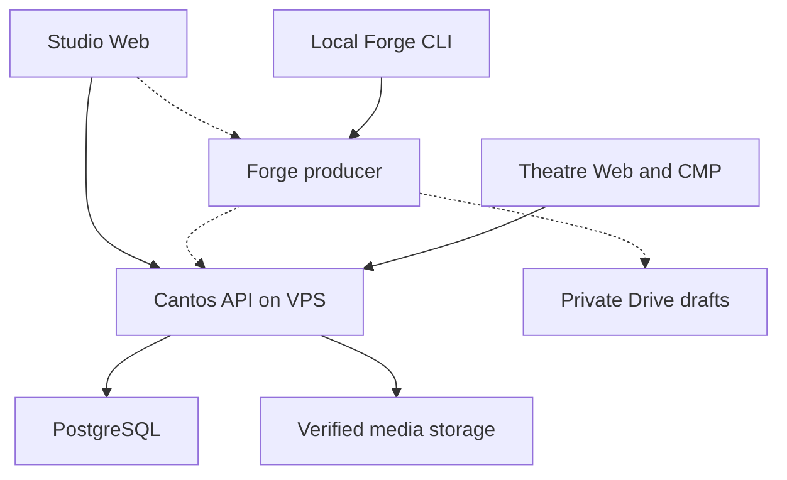

# Cantos Architecture Overview

Current boundaries: [ADR 0018](../decisions/0018-external-audio-production.md) and
[Forge ADR 0022](../decisions/0022-cantos-forge-producer-cli.md).
Backend TTS/provider workers and their DBSP job-summary adapter are historical.

## System boundaries

Solid edges describe existing component boundaries, not live end-to-end acceptance.
Dashed edges describe #203's **planned** producer execution, Drive persistence and API handoff.
Forge currently registers/checks/exports local artifacts; it does not yet call Gemini, serve
HTTP or submit to the API.

Studio owns the buttons, configuration, status, preview and explicit acceptance. Its planned
second backend is Forge via local/deployed Firebase Functions. CLI and Functions must invoke
the same Rust use cases through thin adapters; the exact Functions runtime packaging still
needs a feasibility decision. No separate Forge GUI or TypeScript copy of production logic.

Cantos API never spawns Forge, stores Gemini credentials or requires Forge for catalog/playback.
Theatre never triggers synthesis. Static Firebase Hosting serves the Web bundles and is a
separate deployment boundary from Functions and the VPS API.

## Layers and contexts

| Owner | Responsibility | Boundary |
| --- | --- | --- |
| Script IR | Structured text, stable IDs, validation/diff | No HTTP, SQL, provider or UI dependency |
| Editorial / Ingestion / Adaptation | Immutable source/script revisions, rights and externally authored proposals | No model inference |
| Production planning | Versioned guidance, cast/performance/rights/budget declarations | No provider dispatch |
| Catalog | Work/unit metadata and separate ContentRevision; optional exact ScriptRef | No mandatory drama workflow |
| Media / Publication | Verified private assets, scoped intake, reviews, immutable releases and active pointers | Private storage is not a public grant |
| Listening | Public release reads and separate account-owned Library/Progress | No Studio permissions or production work |
| Forge producer | Local artifact foundation; planned provider execution, attempts and private draft I/O | Outside API; no authoritative Catalog or publication |

Use domain → application → adapters: pure typed decisions, explicit use cases/authorization and
thin HTTP/PostgreSQL/storage/provider effects. Apps share versioned contracts, not service code
or each other's application internals. See [API contexts](api-contexts.md) and [layout](repository-layout.md).

## Data and delivery

PostgreSQL owns authoritative metadata, content/brief/review revisions, permissions, receipts
and release/listening state. [Private storage](object-storage.md) implements filesystem/S3
adapters and immutable original-target reads. Object I/O and SQL are not one atomic transaction;
admission verifies actual bytes and reauthorizes before durable metadata acceptance.

[Audio Lifecycle](../../packages/contracts/audio-lifecycle-v1.md) uses an owner-prepared
submission and a separate producer bearer for one capped binary PUT that admits/finalizes.
Do not infer direct S3 presigned writes or a separate finalize endpoint from the broader
[handoff proposal](../../packages/contracts/external-audio-handoff-v1.md).

For #203, private personal Drive holds producer drafts/indexes/attempt state and audio previews;
offline local-only work uses filesystem. Keep the existing [story layout](../production/story-workspace.md)
and immutable revisions/checksums. Google/Firebase adapters and credentials stay outside domain
and Script IR. Drive is not a second Catalog, public media host or proven transactional
coordination mechanism; paid-attempt concurrency and unknown outcomes are explicit gates.

Publication/Discovery/Library cores exist. [ADR 0032](../decisions/0032-theatre-origin-playback-delivery.md)
proposes origin-controlled delivery with an implemented gated core; [ADR 0038](../decisions/0038-publication-streaming-evidence-gates.md)
keeps real isolation/Range/expiry/withdrawal and Web/native acceptance separate. Unconfigured
ordinary composition remains unavailable. Changing private write targets moves no old objects.

Historical migrations 0007–0009 stay intact for checksum/upgrade compatibility. No retention
or table drop is authorized by documentation cleanup. The generic optional DBSP library remains;
its retired synthesis-job summary is not an active backend use case.

## Authentication and security

Studio, Theatre and Admin have distinct credential/actor/session boundaries. Studio has
provisioned-only administrators; Theatre self-registration is accepted policy with unfinished
issuer/onboarding acceptance. [Theatre identity](theatre-identity.md) owns the current state;
#206's Firebase proof option is not activated by this document.

Producer Brief reads, Audio Lifecycle uploads and Catalog delegation have separate scopes.
Never reuse a Studio cookie as a producer credential or assume a Catalog grant authorizes audio.
The planned Forge endpoint must authenticate every generation/status/preview/draft request
server-side, even when its HTTPS URL is publicly reachable. Private Drive OAuth and Gemini
secrets stay in trusted adapters, never Leptos/WASM, logs, manifests or Git.

## Media and verification

The private intake has four explicit Ogg/Opus mono 20/24/32/40 kbps envelopes with no implicit
profile choice ([ADR 0020](../decisions/0020-studio-private-audio-intake.md)). Raw audio/image
bytes are not Protobuf metadata. AAC and cross-platform playback are separate profile decisions;
format admission does not prove listening quality or publication rights.

Use the [implementation status](../product/brief.md#implementation-status), versioned contracts
and source-bound [evidence](../evidence/README.md). `cargo xtask` owns local checks; provider,
deployment, browser/native and end-to-end acceptance require their own named observations.
