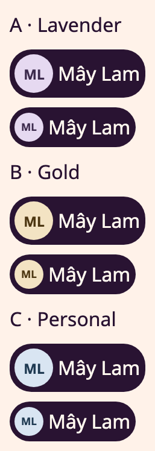
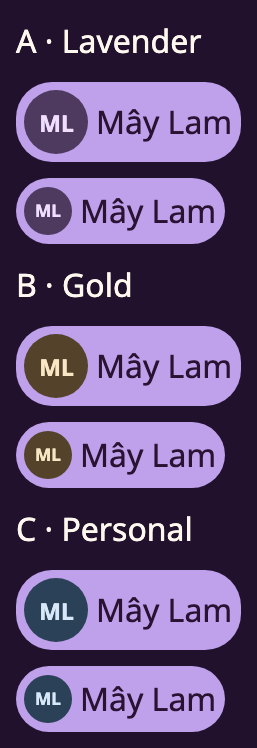
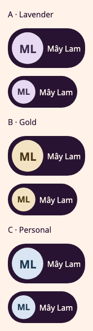
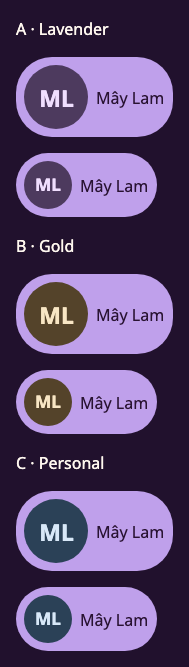

# Generated Theatre account identity: source and renderer evidence

Scope: #670 and #662, one draft PR from `develop@e09bd769c1f1ef196150caf0cff98d3e00f87c9a`.
This record accepts no deployment, real account flow, device or shared UI qualification.
The [contract](../../../services/cantos-server/contracts/theatre/account-presentation/v1/README.md)
owns the recipe and boundary. The work queue is unchanged: these issues remain the execution
owners. No migration, auth/session format, mailbox proof, profile CRUD or photo source changes.

## Source and architecture

One Server recipe computes a frozen V1 pseudonym and opaque display seed from the durable
actor. The existing Listening application service projects it; HTTP only admits and renders.
Web/CMP consume the same response and shared Pair initials. Web binds the payload to the
existing account generation; CMP checks current intent, exact admitted grant and expiry before
publishing an asynchronous display result. Display failure grants/revokes no authority.
Guest geometry remains unchanged. Personalized profile/navigation use 64/48-unit circles and
the existing Lavender token pair. Gold and stable personal tones are diagnostics only.

Behavior impact: `cantos.identity.bearer-lifecycle` is an existing draft executable capability;
no lifecycle guard changes. The optional display callback reuses its existing late-result
fence, with a new Kotlin regression. The pseudonym is a pure projection, not a new state
machine. No model expectation/lifecycle was edited. The selected model gate remains owed.
Broad Kani selectors reach unchanged kernels through contract/module paths; the ignored
assurance record gives NOT_APPLICABLE reasons per kernel and defers the model verifier.

## Checks actually run

All commands used the isolated task checkout. Logs are retained in ignored
`artifacts/agent-runs/avatar-670-662/`. The [source manifest](source-manifest.json) binds changed
source bytes to this record; capture metadata explicitly retains its producer's
`source_revision: unrecorded` rather than inventing a revision.

| Check | Result and actual boundary |
| --- | --- |
| Production alias module, narrow Cargo harness importing the actual source with `#[path]` | PASS: independent hashlib golden vectors for four validated actors and replay/reconstruction. `cargo test --offline --manifest-path /tmp/cantos-avatar-core-probe/Cargo.toml`. This is pure-core evidence, not a Server build or signup journey. |
| Theatre Web native suite | PASS: 579 tests. `CARGO_TARGET_DIR=/tmp/cantos-avatar-web-target CARGO_INCREMENTAL=0 cargo test --locked -p cantos-theatre --features preview --lib --config 'profile.test.package.cantos-theatre.opt-level=1' -- --test-threads=2`. Includes canonical Unicode/tone vectors and presentation clearing/out-of-order account switch. |
| Shared Leptos Avatar suite | PASS: 12 tests. `cargo test --locked -p cantos-ui --test avatar` with the same target directory. Includes pinned tone, picture priority, URL refusal and initials. |
| Theatre Web WASM | PASS: `cargo check --locked -p cantos-theatre --target wasm32-unknown-unknown --features preview`. This compiles the real cookie presentation fetch, not just native test code. |
| Theatre CMP | PASS: `cargo xtask theatre-preview verify`: shared 622 executed/pass, 3 configured skips; sandbox 175 executed/pass, 4 configured skips. Native HTTP decoding, two actors, non-cancellable late display response, logout/restore and unchanged logout confirmation are exercised with synthetic ports. No real Identity/device acceptance. |
| Shared CMP UI | PASS: `cargo xtask ui-preview cmp verify`, 320 tests; then only `GeneratedAliasCaptureTest` rerun after selecting a distinct Sky seed for C. Production Avatar over the JVM Compose test root; no native device. |
| Leptos preview | PASS: `NO_COLOR=true CARGO_TARGET_DIR=/tmp/cantos-avatar-wasm-target CARGO_INCREMENTAL=0 trunk build preview.html --locked --dist <task-artifacts>/web-preview`, from `packages/ui-system/leptos`. Loopback IAB inspection of Light/Dark and 320px/200% Dark confirmed ML fits, exact 64/48 diameters and canonical computed colors. No real authenticated account was used. |
| Format/whitespace | PASS: `cargo fmt --all -- --check`; `git diff --check`. |
| Clean-base repository primitive | PASS at the pinned base in a separate local shared clone: `python3 scripts/check_repository.py --base e09bd769c1f1ef196150caf0cff98d3e00f87c9a`. |
| Changed repository primitive | FAIL: stale shared UI qualifications and downstream admission refusals. Newly introduced architecture/resource-owner findings were fixed. The qualification failure is a regression of this diff, never a baseline exemption. |

Initial failures are retained: full Server compilation exhausted disk while archiving
`turso_sync_sdk_kit`; an unoptimized Web test binary was corrupted during stripping for the
same reason; a new response test initially used an unavailable `copy` method; one Web regression
caught the accidental guest-size change. The test defect and guest change were fixed, and
their affected suites subsequently passed. Only this task's recreatable Cargo outputs were
removed after retaining logs; other worktrees/data/caches were preserved.

## Opened visual evidence

Synthetic fixture `Mây Lam`, same opaque seed in each direction; C resolves Sky. Each pair
shows profile 64 and navigation 48. Both themes use bundled Noto; narrow captures set preview
text scale to 2.0. Adjacent text names the decorative avatar. No border, shadow or gradient
was introduced. Token contrast pairs remain unchanged. This is qualitative inspection against
the three Drive Me v9.1 images named in #670; it is not a pixel comparison or approved-reference
qualification. Images are documentation-only screenshots and are never packaged by an app.

| Light | Dark |
| --- | --- |
|  |  |
|  |  |

All four PNGs were opened and inspected after the final capture. Their adjacent JSON records
retain bitmap size, viewport, density, font source, token digest and PNG digest. No screen-reader
walk, OS reduced-motion test, Android/iOS runtime or real sign-in was performed.

## Remaining acceptance and review

- Full preflight cannot pass: the selected locked Node 24.19.0/Quint tool is missing. No model
  PASS is inferred from native tests. Resume the registered `cantos.identity.bearer-lifecycle`
  gate using the pinned tooling; no model changes are proposed.
- Shared Avatar's API/source change makes 20 existing Leptos qualification records stale and
  triggers downstream two-renderer admission refusals, including the new CMP Avatar imports.
  Keep all existing records unchanged. Re-run/review the required scenarios against approved
  matching references and record actual evidence before adoption/merge. Gallery tests and these
  images do not waive the admission gate.
- Full Server compilation and the production real-Identity cookie/Bearer router journey remain
  unrun locally due disk. The journey now includes presentation parity, no-store, raw-ID absence,
  mixed credentials and foreign-session refusals. Run it in CI/a prepared environment with space.
- #662 AC-07 still needs the same real account on a signed-in browser and Android APK/device,
  narrow/large text, Light/Dark and switch/logout/relogin observations. No test account was
  requested or credentials invented. No merge, deployment or APK distribution was performed.
- #670/#662 acceptance remains partial: source integration and scoped synthetic evidence exist;
  shared admission and real renderer/account acceptance are not complete. Do not auto-close.

Read-only review covered all changed source, call sites, fixture generation, dependency direction,
session fences, image optionality, localization and visual evidence. Required evidence gaps above
block ready/merge status. No unrelated product change or new dependency was introduced.
