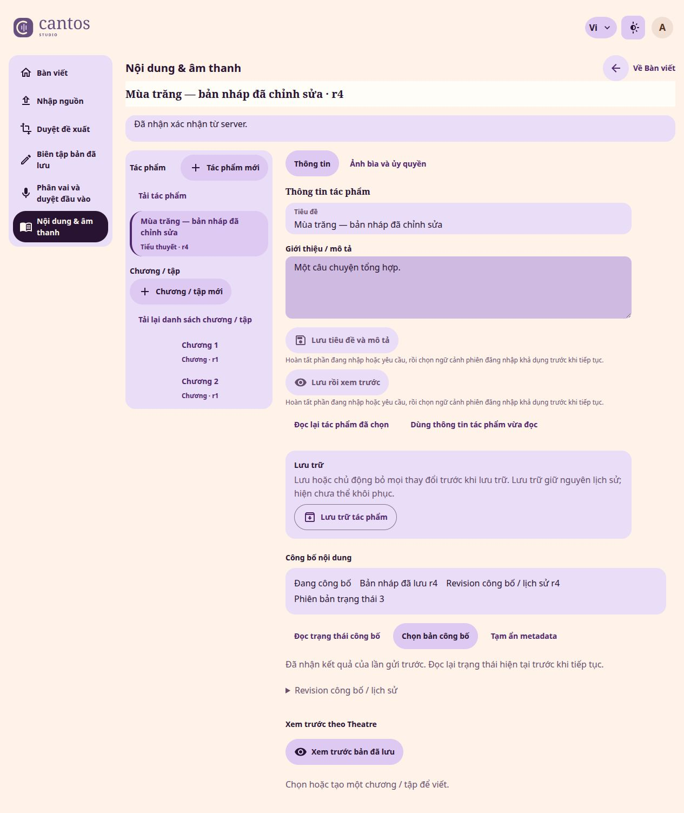
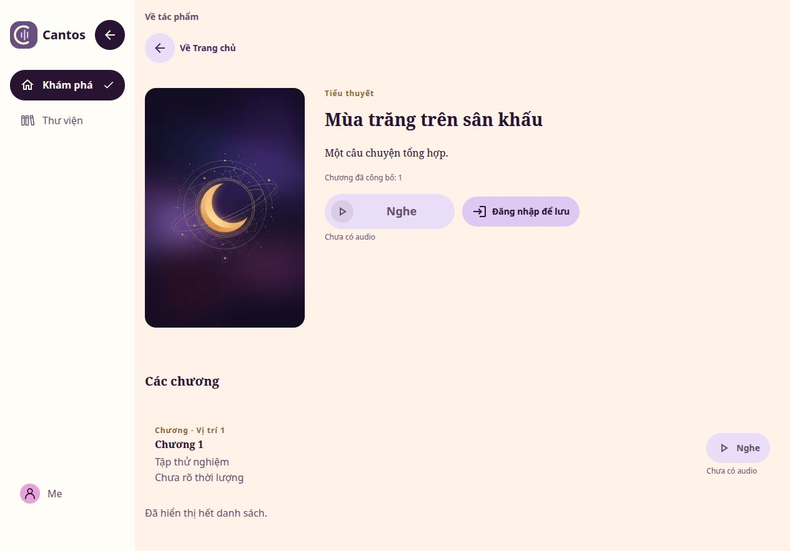
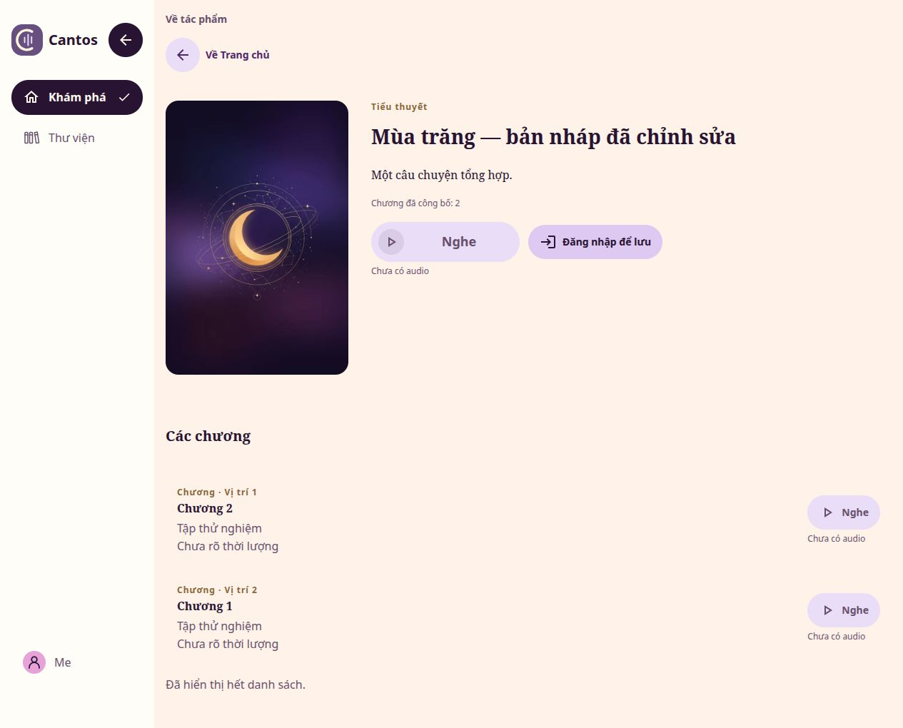

# Studio metadata publication and generic Discovery — #651

This is a bounded source and loopback evidence record for S05 of #634. It does not accept a
native device, real identity journey, deployed service, rights claim or human-listened audio.

## Provenance and boundary

- Base: `origin/develop@0901b20b9a97d3b10780bef91ec93e1c3b43f13c`; branch `codex/651-studio-publish` in a new worktree.
- Implementation patch SHA-256: `0016e129c1f0c33999fbfec9274b82b2d8fe9fa4279c4ae8a8f4cc5b60139bf4`, from
  `git diff --binary origin/develop HEAD -- apps packages services specs`; verification-only
  follow-up changes are identified by the PR head. Captures precede the test-oracle repairs
  and callback whitespace formatting in later commits; these change no rendered markup or
  runtime decision, and no repeat browser observation is claimed.
- Linux, Rust 1.98.1, locked Cargo dependencies; behavior uses Node 24.19.0, npm 11.9.0 and
  Quint 0.33.0. JVM checks use the existing Theatre Desktop target and repository Gradle inputs.
- In-app browser, default desktop viewport and an explicitly measured 390 CSS px viewport;
  vi-VN/en, system/light/dark observations are separate from Android/iOS qualification.
- `studio_metadata_browser_fixture` uses real file-backed Turso, the production `server_router`,
  exact Studio/Theatre origins, private artwork reads and real metadata commands. Only its
  Identity session endpoint is a synthetic test boundary. No Identity executable or login is
  claimed by this fixture. Account service stays unavailable in Theatre.
- All titles and chapters are synthetic. Images below are **documentation-only test
  screenshots**, allowed by [image policy](../design/runtime-images.md); no application consumes
  them. They are original JPEG captures, without alteration.

## Invariant, owners and SSOT impact

Only explicitly selected saved generation pins reach public Discovery. Saving a draft changes
no published text. Metadata publication, audio activation/association, metadata withdrawal and
Catalog archive have separate authority. A write receipt is historical; only a fresh GET can
establish current pointer state. Timeout/retry retains the original operation and payload.

Catalog owns immutable generation/CAS/receipt policy. Media composes exact audio and image
clearance with those pins; Theatre HTTP owns the single anonymous representation. Studio owns
its frozen review, dirty form and one-flight request state. Web and CMP own independent strict
consumer types. There is no shared service contract crate or client ACL.

The impact lookup is recorded in the module inventories and `specs/behavior/catalog.json`:

| Capability | Lifecycle / class | S05 consequence |
| --- | --- | --- |
| Metadata generation / publishing lifecycle | draft, model absent; approved requirement adoption plus missing client/shell scenarios | Existing ADR 0054/0055 semantics; native state/router regressions, no invented model acceptance |
| Sample metadata | deprecated; approved D07 retirement | Stable ID and historical model/manifest preserved; no public read lane or backfill |
| Public playback / covers | draft; changed generation eligibility/pin input | Existing grant, expiry and post-open kernels unchanged; native generation admission tests added; no conformance claim from the models |
| Presentation | renderer composition and paired copy | Existing Button/Checkbox adapters and semantic tokens; no shared primitive or navigation redesign |

Preflight derives `impact:unknown` because the canonical localization catalog broadens its
selection. The ignored assurance record requires workspace Rust and Web lint evidence. It
never waives a failed repository/renderer gate or native acceptance.

## Browser observations

1. Studio saved Work r4 while its state read named published r3/v1. Theatre showed the r3 title,
   only Chapter A, and disabled Work/Unit Listen controls. An unpublished draft chapter was not
   implicitly selected.
2. In-place review retained published A, explicitly added B and moved B before A. Work revision,
   complete order, Unit revisions and exact r3/r4 cover selections were shown. Both cover reads
   returned explicit absence; unread cover state was a different presentation.
3. Dirty Vietnamese text, selection order and rights confirmation survived locale/theme and
   viewport changes. Publish and Preview stayed disabled while the form was dirty. At 390 CSS
   px, document width was 390 px; identifiers wrapped and keyboard focus reached the candidate
   control. This is bounded layout/keyboard evidence, not screen-reader or IME composition QA.
4. Publish selected r4/B/A reached the actual Server mutation. The receipt left current state
   unread. A fresh GET established r4/v2. Theatre then showed the new title, B then A, count 2,
   and disabled Listen controls for metadata-only entries.
5. A second explicit order change produced v3. While current state was unread, the review kept
   its read r4 baseline and old positions. Closing review restored focus to
   `metadata-review-open` after its DOM control became enabled.
6. Browser automation stalled when opening the native metadata-withdraw confirmation;
   `getJsDialog` exposed no dialog and subsequent focus/close calls timed out. Confirmation
   acceptance and archive/withdraw interaction qualification remain **NOT_RUN**. No successful
   destructive action is inferred from that click. Server withdrawal and grant denial are
   exercised independently by real-file/router tests.

### Published and saved state in Studio



### Theatre before explicit metadata publication



### Theatre after selecting r4 and B then A



## Independent evidence and reproduction

Full local logs, setup receipts, source fingerprints, DOM observations and uncommitted narrow
captures remain under ignored `artifacts/agent-runs/651/`. The PR records final gate results;
a later packaging commit does not itself re-run or accept a gate.

| Layer / claim | Evidence and limit |
| --- | --- |
| L1 Architecture | Existing Catalog → Media → HTTP facade; consumer-owned DTOs; no SQL registry, provider or dependency changes |
| L2 Domain / types | Existing generation decisions and validated snapshots; private frozen review, exact response correlation and bounded explicit selection |
| L3 Pure / static | Studio library: 464 tests PASS; Theatre Web library: 575 tests PASS, including strict reads, bounds, old published pins, same-operation recovery, mismatched replies and exact artwork reads. Behavior/protobuf/reference runs are independently recorded; model PASS is model-only |
| L4 Adapter / orchestration | Kotlin catalog/cache focused suite PASS; production HTTP adapter exercised, strict old/malformed shapes refused. Host/JVM is not device playback |
| L5 Real file / HTTP / bytes | Server generation/router, audio association, immutable manifest, cover and creator→origin tests use real Turso/files. The origin regression withdraws metadata while audio stays active and refuses a previously issued media grant. Seeded domain chains and named delivery doubles retain their disclosed limits |
| L5 Browser | The six bounded observations above; synthetic session boundary, no native audio or deployed origin |

Relevant commands, from the checkout with Rust 1.98.1:

```sh
cargo test --locked -p cantos-studio --lib
cargo test --locked -p cantos-server --test catalog_http_turso \
  creator_intake_to_explicit_publication_uses_real_origin_bytes_and_reconciles_after_reopen
cargo test --locked -p cantos-server --lib \
  test_support::metadata_publication_tests::studio_metadata_browser_fixture -- --ignored --exact --nocapture
cargo xtask app cantos-studio --web
CANTOS_API_ORIGIN=http://127.0.0.1:8080 cargo xtask app cantos-theatre --web
cargo xtask preflight --changed-only --base origin/develop
```

The local build host lacked dav1d development metadata. The matching official apt development
package was extracted under ignored artifacts and selected through `PKG_CONFIG_PATH`; no system
package or runtime host was changed. The exact Node/npm runtime and locked Quint installation
were also isolated under ignored `target/verification/`.

### Cumulative local check ledger

Source checkpoint: `75e2890a`. Later evidence-only commits do not change the compiled input.
These are independently attributed runs, not a passing aggregate preflight. `--skip` always
remains NOT_RUN in its own continuation; earlier passing checks are reused only for unchanged
inputs. Remote CI was neither queried nor awaited.

| Gate / run | Observed result | Provenance and limit |
| --- | --- | --- |
| Behavior, Script IR reference, Protobuf reference/drift | PASS | `preflight-layers.log`; behavior is model-only, no implementation conformance |
| Rust format / workspace lint | PASS | `preflight-render-final.log`; the intermediate test-array format and WASM callback lint failures were repaired |
| Workspace Rust tests | FAIL in the original aggregate run | `preflight-remaining.log` stopped at the old audio-table fault assumption; the repaired complete `theatre_contract` target passes 4 tests. `rust-remaining-packages-final.log` passes every non-Server workspace target, including Studio 464 and Theatre Web 575; remaining Server WAV/wire targets pass in `server-remaining-contracts.log`. Earlier Server suites retain their unchanged production inputs. No whole workspace PASS after those test-only repairs is claimed |
| Forge functions / Turso | PASS | `preflight-renderers.log`. The engine report has 42 PASS, 3 UNSUPPORTED, 3 FAIL and zero differences from recorded expectations; those expected engine gaps are not accepted capabilities |
| WAV reference / installed audio inspection | PASS | `preflight-web-final-2.log`; five independent Python/ffprobe PCM comparisons and the two explicitly ignored real-tool inspection tests. No listening-quality claim |
| Web lint, Studio/Theatre build, shared Leptos preview | PASS | `preflight-render-final.log`; both preview and production WASM lint lanes, both app builds and shared preview build |
| Shared CMP preview | PASS | `preflight-render-final.log`, installed JVM/Desktop test target; no Android/iOS claim |
| Script IR mutation | PASS | `preflight-render-final.log`; the isolated baseline passes 16 tests, all nine mutants are killed, with no survivor, timeout or unviable mutant. This qualifies those Script IR assertions, not publication-state conformance |
| Theatre CMP broad / focused catalog-cache | FAIL broad, PASS focused | Baseline artwork/logout-layout failures remain. The scoped production adapter/cache suite executes 60 tests with one live-origin test skipped; no device or live-origin qualification |
| Repository | FAIL | Same 60 qualification findings on the pinned baseline and this branch; zero branch-only findings after repairs. Controlled Python: 1,337 tests, one baseline fixture/umask failure, 18 skips; registry-specific suite: 114 PASS |
| Assurance | FAIL | `impact:unknown` explicitly requires workspace Rust tests and Web lint. A skipped workspace test gate is NOT_RUN in the continuation, so the REQUIRED obligation cannot pass; no waiver or fabricated PASS |

The final renderer continuation uses:

```sh
cargo xtask preflight --changed-only --base origin/develop \
  --skip repository --skip behavior --skip rust-tests \
  --skip script-ir-reference --skip protobuf-reference \
  --skip forge-functions --skip turso --skip wav-reference \
  --skip audio-inspection --skip theatre-cmp-preview \
  --assurance-decisions artifacts/agent-runs/651/assurance.json
```

The earlier WAV reference attempt failed because its default binary path is worktree-local
while the Cargo build used the shared `CARGO_TARGET_DIR`. An ignored local symlink to that
actual compiled binary resolved the path; no oracle or production WAV code was changed.
The continuation ends FAIL only at its assurance decision because the workspace test gate
is skipped. The original repository, workspace-test and Theatre CMP failures remain in their
own records. A clean aggregate result still requires the full workspace gate and the outstanding
repository/CMP qualification; passed independent layers do not waive those requirements.

The test-hosted API and both owned frontend sessions have ended. No listener remains on their
8080/8081/8082 ports; mutation copies and compiler children completed normally. The requested
worktree and ignored evidence are retained, and the main checkout's unrelated untracked
table-ownership record is untouched.

## Failures, deferred acceptance and residual risk

- The behavior registry contract suite passes 114 tests after fixture mutations were pinned to
  the live audio-admission capability and the retired sample was explicitly excluded from the
  executable index. Its historical scenario import remains registered.
- The initial Python discovery campaign exposed stale registry test assumptions (repaired), plus
  native sidecar-fixture mode errors and a localization fixture that assumed a default branch
  other than `develop`. Both latter classes reproduce on the clean baseline. The independent
  controlled campaign uses a process-local `umask 077` and `init.defaultBranch=main`, preserving
  the user's global Git configuration and native security guards; it ran 1,337 tests with 18 skips and one failure. The remaining legacy VPS fixture creates a
  `0755` directory without overriding the process umask, so `077` turns its intended bad-mode
  input into `0700`; the same failure reproduces on the pinned clean baseline. No legacy VPS
  implementation or security guard was changed.
- Repository verification has 60 UI qualification findings on both this branch and the pinned
  clean `develop` baseline, with no branch-only finding after the focused fixes. Their hashes
  were not rewritten to manufacture qualification.
- Initial CMP broad runs failed on artwork decode and narrow logout-layout cases also reproduced
  on `develop`. The in-scope catalog/cache regressions were repaired and the focused suite passed.
  Full CMP/device qualification stays separate; generated localization does not establish it.
- Historical Work field text is absent from publication state and cannot be reconstructed from
  a newer head. Revision/order comparison and exact cover selection comparison are implemented;
  full old/new Work field text comparison needs a reviewed Catalog owner read contract.
- Library release presentation and restricted/cache/native media remain successor integration
  boundaries. S06 must not enable restricted audiences until every affected text and byte path
  enforces them. No claim here accepts those paths from public Discovery or a model run.
- Android/iOS runtime, TalkBack/VoiceOver, IME composition, browser conflict/lost-response fault
  injection, motion and deployed HTTPS/identity/audio acceptance are NOT_RUN. Run the relevant
  platform scenario with real prerequisites before accepting that target; owners are unassigned.
- No cache/index optimization or latency benchmark is claimed. Reads use bounded generations,
  a page-wide audio lookup and batched cover facts in one snapshot. S11 owns measured budgets.
- No deployment, conversion, release admission, real provider cost, publication approval or
  legal-rights acceptance occurred. Old presentation selectors fail closed; an audio release or
  sample attestation without a generic generation grants no public Discovery or media access.

Screenshot SHA-256 values:

```text
ebb780ada02a01279e99fa03a10150ec408db66a49c51a0e6923d4a85af02570  studio-published.jpg
49702b899e177ffb34566f13cb7f85f3c122d38ffbc3cda3da1f094e6146cb94  theatre-after.jpg
82a13eacce5ff3ae62e62c0b73267e92c6d9e35ec4fb2afd4cb6c7c5cf81b0af  theatre-before.jpg
```
