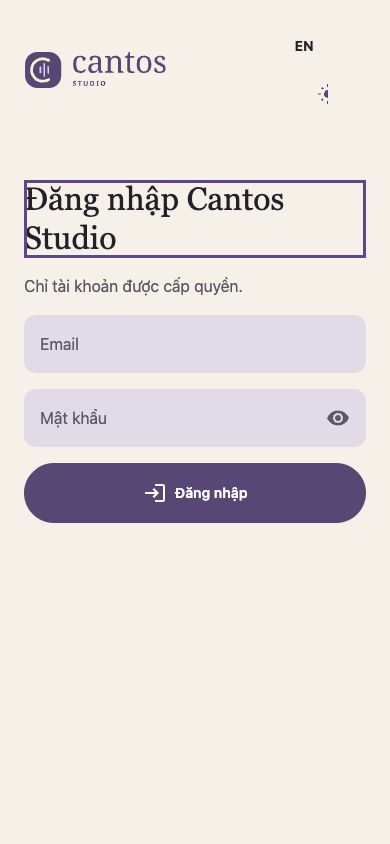
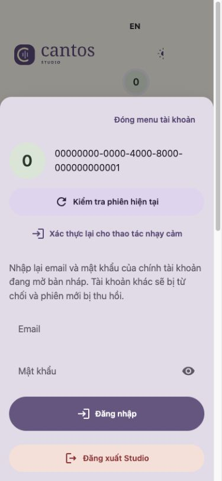
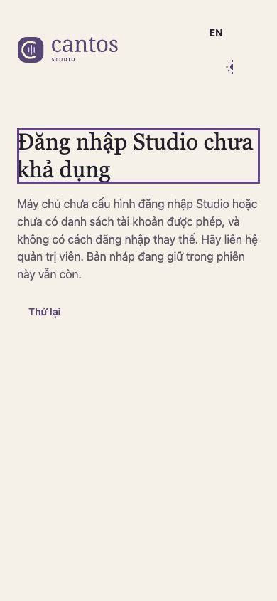

# Studio six-issue review — 2026-10-26

Base: `develop` at `5d558ea1e5cf76d4704e53b41c7ea11aff7e0695`. Reviewed current issue bodies and comments (none), merged source and the linked UI handoffs. Closed issue state is not acceptance evidence. Astra xhigh independently reviewed the bounded final source diff. No provider, deployment, live authentication or production data was used.

## Issue to implementation and gaps

| Issue | Existing implementation | Confirmed outcome and residual acceptance |
| --- | --- | --- |
| #491 | `3d3ef515` / #496; `navigation.rs`, shared `NavItem`, workspace return handling | Current source mounts workspace navigation and preserves the existing owner; no navigation rewrite needed. Full browser back/forward, IME and retained-draft flow matrix remains NOT_RUN. |
| #493 | `bf71e4b1` / #502; `signin_form.rs`, favicon and shared password/`AuthPrimary` controls | Same input reveal and compact entry are wired. This review clears reauthentication credentials on disposal and rejects late updates to that form; native regression plus browser close/reopen pass. |
| #498 | `ea01d25c` / #503; entry copy | Prior implementation shortened both LoginHelp translations and made MemoryHelp conditional on unsaved state. This review removes the duplicate form-level access explanation. Requested leading Mail/Lock field icons and full preview/design adoption remain incomplete. |
| #500 | `344a14b2` / #509; inspector `ActionButton` calls | Prior change migrated seven inspector actions. This review removes duplicated revision permission help and dashboard lead/page-help prose. Authoring still has 16 raw action controls plus four native navigation controls, production eight raw action controls; safe migration needs their focus/confirmation contracts, not a mechanical replacement. |
| #490 | `12ae4873` / #494, partly superseded by `9c6d0c46` / #508; account/header | Fixed actual WASM compile failure from unsupported `ActionButton.class` using shared `Danger` variant. Added explicit localized close control, initial focus, dynamic Tab bounds and form disposal. Group remains nonmodal; background inertness and screen-reader acceptance are not claimed. |
| #489 | Existing Studio/artwork CSS retained outward 4px rings | Uses inset negative focus-width offset and the shared focus color for artwork. Shared floating-field focus ownership remains intact. Full contrast measurement and all-control/device matrix remain NOT_RUN. |

## Design and shared ownership

Read the linked `AUDIT-HANDOFF.md` and `HANDOFF.md` and opened the actual `04-mobile-light-signin.png` reference for #498. The latest concise-copy addendum governs prose; the illustration is not acceptance of current runtime. Fresh current-source browser captures at 1280×720 and 390×844 show the remaining design differences, especially missing leading icons.

Shared Tooltip/ThemeCycleButton admission/qualification from #497 is incomplete: exported macros evade the current component-catalog scanner and the catalog does not qualify them. Source review also found tooltip pointer/focus persistence gaps. Browser testing confirmed the theme tooltip can overflow horizontally at 390px while visible; overflow disappears on focus leaving. These shared-owner defects are disclosed, not silently repaired or marked qualified here. Studio is web-only; no CMP renderer changed and Web/CMP parity is not inferred.

No registered Studio account, entry, navigation or action behavior model/native binding covers this presentation scope. The server native-session draft model is unrelated. Quint is NOT_RUN for this change; no model PASS or new proof campaign is used as runtime acceptance. Existing session and form native regressions remain the authority for the state semantics exercised here.

## Current-source captures

These captures use the synthetic local HTTP fixture at 390×844, not live accounts. The UUID is a fixed test actor. Empty reauthentication fields and the explicit close control are visible.

## Evidence ledger

- PASS: baseline Studio native tests, 387 tests plus two doctests.
- FAIL (baseline): WASM compilation rejected unsupported `ActionButton.class` in `view.rs`.
- FAIL before fix, PASS after fix: owner-disposal regression proves typed email/password are erased and a pending form result is rejected after reauthentication unmount.
- PASS: modified Studio native suite, 388 tests plus two doctests.
- PASS: `cargo xtask build cantos-studio --web` on the current source. Initial packaging ran out of disk; retry passed after removing only this task's identified incremental artifacts. No gate was relaxed.
- PASS (local HTTP double): current WASM bundle in browser; account initial focus, Shift+Tab/Tab wrapping, Escape/close restoration, credential close/reopen clearing and password reveal/reset and 404 sign-in-unavailable hiding the credential form; desktop 1280×720 and narrow 390×844 sheet bounds inspected. Synthetic session/error responses only, not live authentication acceptance.
- PASS (visual observation, limited): current light/dark entry and narrow account rendering inspected against the supplied reference; no claim of full visual/contrast/device acceptance.
- NOT_RUN: live server identity, real authenticated private workspace, screen reader, IME and device/browser matrix. No deployment or provider operations authorized for this task.

Final-diff preflight stopped with `repository FAIL` and later gates `NOT_RUN`. Running the repository check on the clean pinned base reproduces stale Leptos qualification records and existing consumer admission failures. The new shared close `Button` also adds an admission failure in `account_menu.rs` against those stale records; this is an unresolved dependency of this change, not entirely a baseline failure. Qualification evidence was not fabricated or refreshed without its real preview campaign.

The available-gates run (`--skip repository`, preserving the original FAIL) passed formatting and native Clippy, then failed to execute its test binary after disk exhaustion during debug stripping. The test process did not execute in that attempt. Follow-up `CARGO_INCREMENTAL=0 cargo test -p cantos-studio --locked` PASS: 388 tests and two doctests. WASM Clippy with `cantos-ui/preview` PASS, including all Studio targets and warnings denied. Final web build, repository Python-suite results and final-head CI are recorded in the PR handoff. Local logs are under `artifacts/agent-runs/six-issue-review/` in the isolated checkout, excluded from Git. Documents-backed file reads stalled during compilation; the exact patch was preserved and applied to a fresh task-local `/private/tmp` worktree at the same pinned base. Unrelated worktrees and fixtures were preserved.

## Deferred acceptance

| Layer | Prerequisite / next check | Owner and risk |
| --- | --- | --- |
| Shared tooltip/theme | Shared component catalog admission, native/renderer tests and fresh hover/focus/390px browser checks | Shared UI owner unassigned; clipped tooltip and incomplete qualification persist. |
| #498/#500 remaining design | Implement missing field/icon and action contracts with generated/shared patterns; preview and current-source comparison | Studio UI owner unassigned; six issues are not fully accepted by this review. |
| Navigation/IME/accessibility | Current bundle against authorized non-production API; back/forward, IME, keyboard and screen-reader campaign | Studio owner unassigned; native PASS does not establish these claims. |
| Live/device | Authorized fixture/backend/device environment; run documented Studio browser matrix | Acceptance pending; no provider or production fallback added. |
