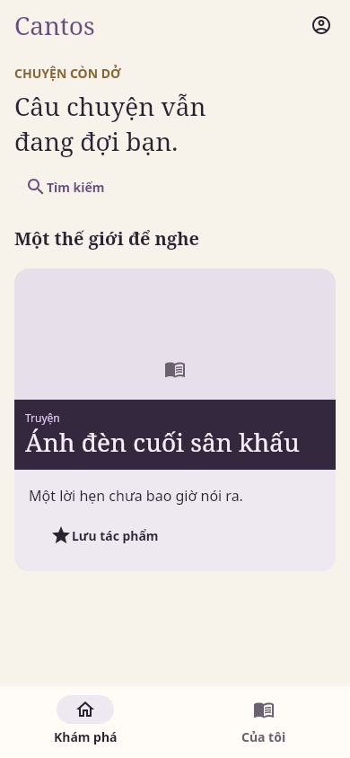
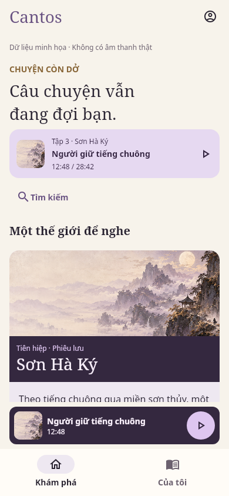
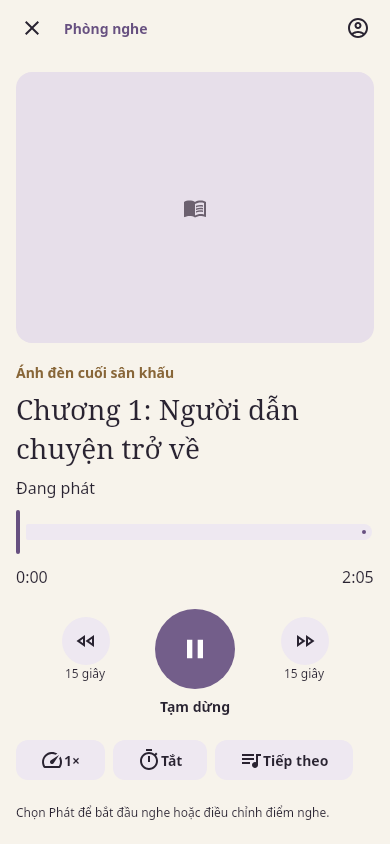
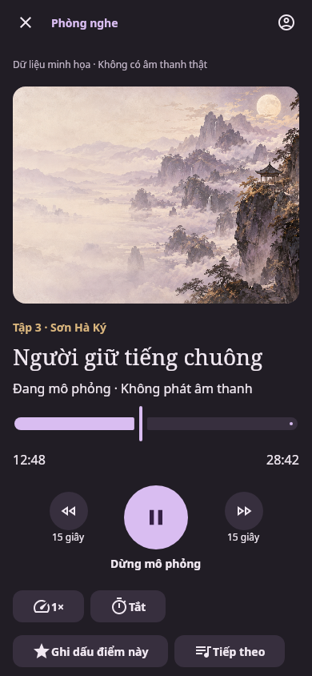

# Theatre CMP: one application, real owners

This record covers the change that put the listener experience of the Firebase demo
(`com.cantos.theatre.demo`, `CantosDemoApp` → `CantosPresentation`) back on the application
that ships as `com.cantos.theatre`, which had been given a simplified browse surface
(`NativeCatalogScreen` → `PublicCatalogScreen`). It distinguishes proposed design, implemented
behavior and verified behavior. It is not native device acceptance.

## What changed

| Before | After |
| --- | --- |
| Production entry `TheatreActivity` → `NativeCatalogScreen` → `PublicCatalogScreen` (list, detail, a text mini-player, a separate account panel and library panel) | `TheatreActivity` → `CantosTheatreApp` (in `:shared`) → `CantosPresentation`, the screens, tokens, motion and copy of the demo |
| Demo entry `CantosDemoApp` over `AppContainer` and the mock owners | Unchanged and sandbox-only: previews, tests and the explicit "Cantos Sandbox" host (`com.cantos.theatre.demo`) |
| Production launcher had no icon, splash or system-bar handling | Launcher icons, colors, `Theme.Cantos.Starting` splash, `CantosLocalLaunch` and edge-to-edge bars moved to `androidProductionApp`; the sandbox host reuses them |

Removed as the simplified parallel UI: `NativeCatalogScreen.kt`, `PublicCatalogScreen.kt`,
`ContentText.kt`, `NativeAccountPanel.kt`, 16 now-unused catalog copy keys (two of them said listening was
unavailable) and their presentation tests. The package stays `com.cantos.theatre`;
no third identifier exists. `com.cantos.theatre.demo` remains only the mock sandbox host.

## Component → data port

`projectTheatreShell` (pure) projects only the owners below into `ShellState`/`ShellCatalogView`;
`TheatreShell` interprets `ShellEvent`s against them. No screen reads a fixture.

| Screen / control | Owner (port) |
| --- | --- |
| Discover, Search (typed text → one debounced server query on the Search route only) | `PublicCatalogController` / `PublicCatalogPort`; cached offline page via `CatalogCachePort` |
| Work, chapters/episodes, Load more | `PublicCatalogController` detail + units walk; phases `Loading/More/Failed/Complete`; a count only when the walk is complete |
| Player, mini-player, Queue, seek, speed | `NativeListeningController` → `PlaybackController` → `AuthorizingMediaEngine` → `AndroidMediaEngine`/`IosMediaEngine` |
| Continue, History, Saved | `NativeLibraryController` (SQLDelight store + outbox); a guest is taken to sign in |
| Account, Login, Register notice | `NativeAccountController` (Bearer session) |
| Theme, language | `PreferencesController` (language persisted) |
| Sleep timer | `TheatreShell`: 15/30 minutes pause the real player; "end of episode" resets at `Ended` |

## What is deliberately absent, and why

| Fact | Behavior | Owner |
| --- | --- | --- |
| Bookmarks | Control hidden (`LocalShellCapabilities`); no local-only fiction | #12 |
| Cover artwork | Existing tonal placeholder | #171 |
| Titles in Library rows | The API returns identities only; a work/unit the process has not been shown is named neutrally (`Tác phẩm`), a known one by its API title | new BE issue (linked from the PR) |
| Episode number / total count | `position` is never shown as a number; a count appears only after the walk completes | #177 and the new BE issue |
| Registration | Existing explained-unavailable destination | #174 |
| Membership | Existing preview in `MembershipMode.Unavailable`; nothing is submitted | #175, #176 |

## Verification

| Layer | Result |
| --- | --- |
| `:shared:desktopTest` and `:preview-sandbox:desktopTest` (JVM, includes the unchanged demo/sandbox suites) | See the PR description for the final run |
| `TheatreShellProjectionTest` (8) | loading/error/empty/ready, partial vs complete counts, detail failure/not found, Library naming, authoritative detail list, playback and pending selection, navigation |
| `TheatreShellTest` (5), `TheatreShellLibraryTest` (3, real account + SQLite) | detail follows navigation, debounced search, real playback only for listed units, guest save, sleep timer, exact/stale/unavailable continue, durable saved intent |
| `CantosTheatreAppTest` (4) | the Discover → Work → Player → mini-player → Library → Account flow with decoder acknowledgement, retry/Load more, not found, cached notice and guest Library, in light/dark at 390×844 and 320×568 at 2× text |
| Android `theatre-host android-release` | PASS: unsigned APK and AAB for `com.cantos.theatre`; inspection finds no sandbox, mock, demo or test content |
| Android `theatre-host android-debug`, `theatre-demo android-build` | PASS |
| `aapt2 dump badging` of the release APK | package `com.cantos.theatre`, label `Cantos`, adaptive launcher icon |
| Firebase (read-only `apps:list`/`apps:sdkconfig`) | `Cantos` → `com.cantos.theatre` and `Cantos Theatre Demo` → `com.cantos.theatre.demo`, both registered; nothing created, changed or deleted |

Not run: an Android emulator/device (none installed on this host), TalkBack/IME/OS Back, real
audio, live API/identity, iOS (Linux host: Xcode and Kotlin/Native 2.2.20 are absent; the iOS owner
change is source-only), and any Firebase App Distribution upload.

## Observed screens

The images are JVM Compose renders of the real `CantosTheatreApp` over fake network/decoder
ports ([capture script](../../apps/cantos-theatre/mobile/shared/src/desktopTest/kotlin/com/cantos/theatre/app/CantosTheatreAppTest.kt))
beside the demo's renders of the same presentation. They establish layout parity and
the absence of sample content, not device behavior.

| Application (real API shapes) | Demo (sample data) |
| --- | --- |
|  |  |
|  |  |

Observed differences, all intended: no "sample data" notice, placeholder instead of the bundled
artwork, chapters/episodes from the API instead of numbered sample episodes, and no resumable
sample in the Discover header. [Work](images/theatre-unified-app/app-light-work-390x844.png),
[mini-player](images/theatre-unified-app/app-light-mini-390x844.png) and the
[dark 320 dp 2× player](images/theatre-unified-app/app-dark-player-320x568-text2.png) are the other
captured states.

## ApplicationId change

`com.cantos.theatre.demo` → `com.cantos.theatre` is a change of Android `applicationId`, not an
update: Android installs the new app beside the demo and cannot replace it. No database or user
data was touched. The demo's Firebase app and releases are untouched.
