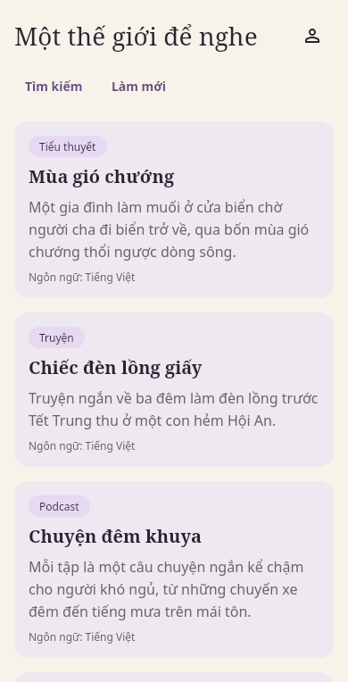
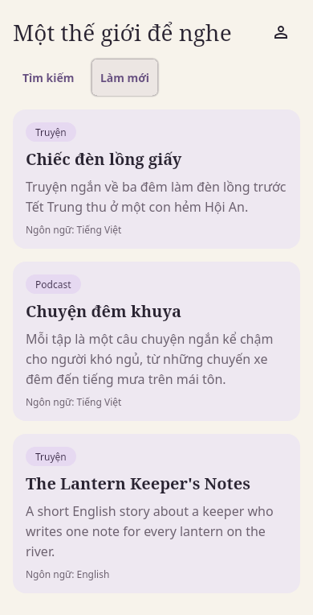
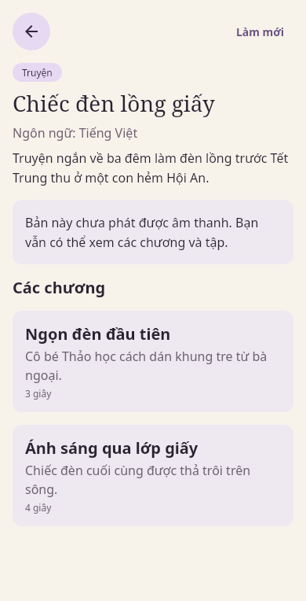
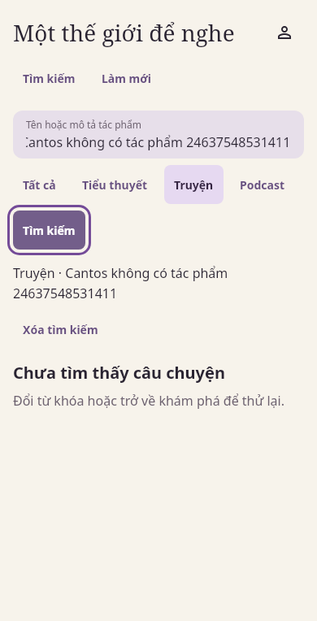
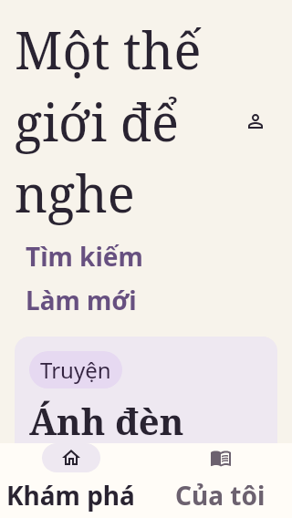

# Theatre real catalog and origin media: step-1 handoff

Scope: backend-owned integration data, configured publication delivery, and production CMP
catalog composition. Native playback belongs to step 2. Source baseline is
`develop@e4d6ca23a51d3f1c1465c7c2da5c2a198f1c3e14`; PR #246 was open and unmerged when fetched,
and none of its epoch-cutover implementation is included. The selected acceptance environment
is **local disposable**, as requested by the owner. No VPS deployment or persistent database
write is part of this run.

The invariant is that public catalog and media identity come from current backend authority,
and an unavailable capability never becomes demo data or simulated playback. The catalog
controller/reducer owns query generations and presentation state; the Catalog/Listener
services own visibility. PublicationService and the PostgreSQL release pointer own admission;
publication storage supplies verified bytes and cannot grant eligibility itself.

## Capability handoff

All listener endpoints below are relative to `/api/v1/theatre`; they use JSON, except raw media.

| Capability | Endpoint | Implementation | Remaining acceptance / owner |
| --- | --- | --- | --- |
| Discovery/search/filter | `GET /works`, `/search?q=&kind=&cursor=` | Existing strict HTTP adapter and reducer; CMP consumes server-side text/kind filters with response-generation fencing. Language filtering remains a backend-only capability | Android/iOS runtime, #159/#14 |
| Work/units | `GET /works/{work}`, `/works/{work}/units` | Direct opaque UUID mapping; pagination, refresh, empty/error/retry; no demo fallback | Device navigation/accessibility, #159 |
| Publication | `GET /publications/{publication}` | Exact immutable rendition/hash/length/duration from approved release | Native consumption, #14 |
| Publication preparation | Studio readiness/publish routes | Authorized gate check, bounded exact private read, immutable copy into separate filesystem class, fresh transaction gate | Real chosen-provider and deployed activation, #10/#11/#170 |
| Playback grant | `POST /publications/{publication}/playback-authorizations` | Configured `OriginPlayback`, short-lived release-bound HMAC grant; unconfigured stays unavailable | Deployed TLS/proxy/capacity, #170 |
| Audio bytes | `GET/HEAD /media/{grant}` | Real publication storage, actual SHA/length, existing Range/conditional transport, pre/post-open eligibility | Native decoder, #14; Web, #13 |
| Artwork/metadata | Existing minimal public DTO | Honest text/cover fallback; no demo artwork or invented metadata | #171/#177/#178 |
| Account/Library/player | No new endpoint usage | Explicit unavailable capability in catalog host; no fake signed-in/saved/playing state | #191/#35/#17 and step 2 |

The deployed API at `https://api.cantoss.duckdns.org` returned an empty Work page during a
read-only probe. `cargo xtask deploy vps cantos-api --host root@42.96.18.245 --status` reported
current revision `4d2153c61c310a16fe90875fce34e2a435e0887c`; this is the deployment state's
reported revision, with image-label parity not separately inspected. It differs from this
branch's baseline and does not establish this branch's deployment. Local integration uses
`http://127.0.0.1:8080`.

## Reproduce local acceptance

Use Rust 1.98.1, PostgreSQL 17/18 binaries on `PATH`, and FFmpeg/FFprobe. The verifier owns its
new disposable cluster; never substitute an existing database URL.

```sh
cargo xtask verify postgres --keep
cargo xtask seed theatre
CANTOS_TEST_CONTEXT=theatre cargo xtask run cantos-api --test-cluster --web-origin http://127.0.0.1:8082
```

Select the retained Theatre context when launching the API:
`CANTOS_TEST_CONTEXT=theatre`. The [seed runbook](../deployment/theatre-seeded-catalog.md) owns
the exact launch commands, journal recovery and persistent-lane prerequisites. The private
receipt `target/revision-evidence/theatre-seed.json` records Work/Unit/Publication/Rendition,
SHA/length, rights window and retained storage/key paths. Audio is an owned synthetic signal;
the first novel rendition lasts approximately 125 seconds. Audio/key bytes are never committed.

The core requires an HTTPS media origin. Disposable API checks follow the returned grant's
exact path on loopback HTTP; this does not establish TLS, ingress logging, proxy headers or
native URL playback. Configure actual HTTPS before step-2 device acceptance.

```sh
cargo xtask theatre-host android-debug --api-origin http://127.0.0.1:8080
cargo xtask theatre-host android-release --api-origin https://api.cantoss.duckdns.org
cargo xtask theatre-host ios-build --kotlin-native-home /absolute/installed/kotlin-native
CANTOS_THEATRE_LIVE_ORIGIN=http://127.0.0.1:8080 \
  CANTOS_THEATRE_REQUIRE_SEEDED=true cargo xtask theatre-demo verify
```

Android package is `com.cantos.theatre`; release inspection checks actual APK/AAB class and
resource exclusion, INTERNET permission, HTTPS-only policy and the configured origin. The
production iOS project/scheme is `iosApp/Cantos.xcodeproj` / `Cantos`, linking only
`CantosTheatre` from `:shared`. Demo targets remain separate. Builds install/distribute nothing.

## Claims and evidence boundaries

| Invariant / failure mode | Oracle / evidence layer |
| --- | --- |
| Startup with empty DB or no selected unit creates no playback seed | Production host/controller source and JVM Compose tests; native runtime separate |
| Arbitrary server IDs/titles, search/filter, retry and refresh never map through fixtures | Common reducer/HTTP tests and production Screen/controller/adapter Compose tests; named fake remote peer versus opt-in actual API distinguished |
| Old query/Work responses cannot replace current state | Controlled delayed-response controller tests |
| Private/unpublished/withdrawn data remains absent | Studio → PostgreSQL → anonymous catalog/manifest checks in the seed integration |
| Approved bytes and grants retain exact rendition identity | Real filesystem hash/length/range/restart/corruption tests, seed HTTP/storage checks and existing grant expiry/withdrawal kernels |
| Persistent seed never resets unrelated data or duplicates an uncertain mutation | Input/target refusal, fsynced original-operation replay, collision and fresh-record reconciliation tests; no live persistent write claimed |

No schema, migration checksum, shared DTO or external dependency changes. Existing indexed
publication-authority reads remain transactionally authoritative; no DBSP/cache/read-model change
or performance improvement is claimed. New preparation copies bytes before the final gate;
an interrupted preparation may leave only an unreferenced publication object.
Serving performs bounded full-object integrity reads before range streaming; throughput and
startup latency were not measured. Deployed capacity acceptance remains with #170.

Verification output and opened captures are recorded in the PR and ignored
`artifacts/agent-runs/step1/`; final checks must name the exact source inputs. A baseline
repository failure is present: both renderer source digests match clean `develop`, while stored
shared-component qualifications are stale. It is not a passed admission gate and must not be
repaired by merely rewriting evidence hashes. New CMP component adoption remains unadmitted
until those qualifications are renewed. Deployment, iOS build/runtime, Android device,
TalkBack/VoiceOver, native playback and human audio listening remain separately reported.

Next owners: #170 for deployed delivery/TLS/expiry/withdrawal/capacity acceptance; #14 for the
native immutable playback session and grant refresh; #159 for per-platform catalog UX;
#179/#180 for acceptance/parity. Keep these issues open until their full criteria are met.

## Observed local handoff — 2026-10-18

The actual environment was created with `cargo xtask verify postgres --suite schema --keep`,
then `cargo xtask seed theatre`. The retained cluster is
`schema/cluster-1792297407986549877`, port `47333`; its independent ownership receipt records
`schema PASS` and full `NOT_RUN`. The seed receipt is local and ignored. No full-run fixture
record was fabricated. Use the portable PostgreSQL tools retained under
`artifacts/agent-runs/step1/tools/pg18/runtime/` (or installed PostgreSQL tools) on `PATH`, with
the runtime's `usr/lib/x86_64-linux-gnu` on `LD_LIBRARY_PATH` when using that local extraction.

| Step-2 identity | Value |
| --- | --- |
| Work | `5eed0001-0000-4000-8000-000000000000` — Mùa gió chướng |
| Unit | `5eed0001-0001-4000-8000-000000000000` — Chương một: Bến cũ |
| Publication | `3ab58252-7e0e-4003-be76-aa6b99bcded6` |
| Rendition | `1c1dc11b-eee5-4816-9bd8-0bd814759b99` |
| SHA-256 | `5f1d605a89728c3a92101975a649ae247d5a95ba43b7728440544e479bd916fb` |
| Length / duration | `384849` bytes / `125000` ms |
| Profile | `opus-mono-24-v1`; Ogg/Opus mono, 48 kHz |

The bound actual server process passed anonymous socket checks: Work pages `[2,2]`, podcast
unit pages `[20,3]`, server text/kind search and terminal empty search, hidden Work/unit/manifest/
grant `404`, complete byte hash/length, HEAD, closed/open/suffix Range, matching/stale If-Range
and `416`. A real 120-second grant expired to `404`; a fresh grant read the same rendition
range as `206`. After stopping the API, restarting PostgreSQL and starting a new API process,
the same catalog/manifest/hash/range checks passed again. Immediate grant withdrawal is covered
separately by the in-process Axum + real PostgreSQL/filesystem seed regression; the socket probe
also checks its withdrawn result remains hidden.

The disposable fixture initially lacked registry SELECT needed by server startup. It now grants
only `SELECT` on `cantos_schema,cantos_migrations` in its newly created DB and invokes the actual
startup verifier using `cantos_app`. Persistent mode receives no grants. The final seed and
actual server startup passed with this regression check.

The mounted production Compose controller used the actual API and observed an owner-authorized
Work visibility change through Refresh, with no client rebuild during the mutation. The monitor
replayed durable operation IDs and restored the original public Work. The live walk observed
4 Works / 31 public units. Error/retry and stale-response cases use named controlled peers in
separate tests; they are not claimed as deployed network acceptance.

| Check / final scope | Result and attributable log under `artifacts/agent-runs/step1/` |
| --- | --- |
| Full Rust checkpoint | `PASS` format/workspace Clippy/tests; `rust-final.log`. Unchanged application sources reuse it; final xtask/fixture deltas have focused checks below |
| Final focused checks | xtask Clippy and 446 tests passed (2 existing ignored); 86 applicable Python tests passed across focused runs; final seed target Clippy passed |
| Contracts / Web | `PASS`; `contracts.log`, `web.log`; inputs unchanged afterward |
| Full PostgreSQL campaign | `FAIL`; `postgres-handoff.log`: OIDC 17 passed / 3 timed out. All 3 exact reruns passed unchanged; clean-base reproduction was not run. Later full stages were not reached |
| Fresh narrow SQL scope | `PASS`; `postgres-schema-owned.log`, including all 20 OIDC tests; full media/restart `NOT_RUN` for that scope |
| Final seed | `PASS`; `seed-local-final.log`, one seed test, 99.76 seconds |
| Actual API/storage / expiry / restart | `PASS`; `live-api-acceptance.log`, `live-expiry-acceptance.log`, `live-api-restart-acceptance.log` |
| Final production Compose/JVM | `PASS`; `cmp-live-accepted.log`: shared 212 and sandbox 219, zero failures/skips; real API tests enabled |
| Android release | `PASS` build and actual APK/AAB inspection; `android-release-accepted.log`; production package `com.cantos.theatre`, explicit HTTPS origin |
| iOS frameworks | `UNSUPPORTED`; `ios-build.log`: pinned Kotlin/Native 2.2.20 unavailable on Linux; Xcode unavailable |
| Final preflight | Final output is retained in `preflight.log` and the PR; shared-component qualification remains an open gate |

The first final JVM run found a real Account hit-target defect (40×40). The production control
now uses the existing 48dp token; all eight light/dark, normal/2× matrix cases passed. Current
pixels and semantics were inspected at 390×844 and 320×568. At 2× both footer labels end at
y=564 inside the 568px frame; Account is 48×48. Scrolling content retains space above the fixed
navigation bar. This is `semantics-tested`, `interaction-tested` and `screenshot-inspected` on
Desktop Compose, with cross-viewport/theme inspection for the deterministic matrix. Native
runtime, screen readers, motion and English large-text acceptance remain `NOT_RUN`.

[Capture provenance and hashes](theatre-live-catalog-step1/observations.json) bind the renderer,
viewport, crop, source digest and data source. The four live captures below are 390×764 content
crops from a 390×844 viewport; the navigation bar is excluded from those crops. The 320×568
matrix image is a full-root deterministic presentation fixture.







Final Android build: `cargo xtask theatre-host android-release --api-origin https://api.cantoss.duckdns.org`.
The release contains the production catalog classes, INTERNET and HTTPS-only policy; inspection
found none of the 70 forbidden sandbox classes or 3 fixture resources. This build points at the
deployed empty API; the local API journey above ran on Desktop Compose, separately.

- Unsigned APK SHA-256: `b38fe1722086fd92203f2b4975a155bc789e58d803384b26fe532b5013522d3e`.
- AAB SHA-256: `55cc495caba97ca787f3aacca23b2f741b74551fa7843422812fd60b089e01c1`.

The API process was stopped after acceptance; the retained cluster and seed remain for step 2.
Start it from this worktree using the explicit Theatre context and Web origin shown above.
