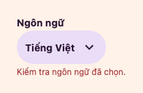
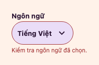
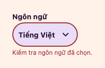
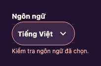

# Post-merge UI review and Theatre Select repair

25 October 2026. This is source-bound review and JVM component evidence, not product,
browser, device, assistive-technology or deployment acceptance.

## Pinned review scope

Fresh clone: `/Users/manhblue/Documents/Codex/2026-10-26/task/cantos-ui-review`.
Branch: `fix/ui-review-select-invalid-20261026`; fetched `origin/develop` base:
`813bbc662454e03dbf1551ca47ed74cd0afc7cef`. No other checkout was changed.

GitHub merge-time search established that the latest three merged PRs were #460, #461,
and #459. #460 changes only deployment documentation and a nonsecret inventory. The three
latest UI PRs are therefore:

| PR | Merged UTC | Merge SHA | Reviewed scope |
| --- | --- | --- | --- |
| [#461](https://github.com/loveoverflowcom/cantos/pull/461) | 2026-10-25 18:00:24 | `67c98b4c4217626e6fa2ffa885ba7b1331fb92f7` | Theatre Discovery/Library Web and CMP compositions, artwork, navigation identities, empty/partial states |
| [#459](https://github.com/loveoverflowcom/cantos/pull/459) | 2026-10-25 18:00:02 | `7f450b86a9c6e6d76cc0f5765acea264e42aeaf9` | Shared qualification, CMP Badge/Dialog/focus repairs, preview typography and recipes |
| [#457](https://github.com/loveoverflowcom/cantos/pull/457) | 2026-10-25 12:36:02 | `fa114100baea6919515a29d4a5b4d9dcb573afa1` | Expressive tokens, fields/trailing actions, actions/Select/Avatar and Web/CMP previews |

Non-UI #460 merged at 18:00:43 UTC as the pinned base above. Review compared each merge
with its first parent and inspected current source at the fetched base, including callers
beyond the diff. Current issues #452 and #453 remain open. #454 implementation is excluded.

Exact merged-head CI was read separately: #461 run
[40215877205](https://github.com/loveoverflowcom/cantos/actions/runs/40215877205) failed
Repository and Rust, with Web passing; #459 run
[40210998750](https://github.com/loveoverflowcom/cantos/actions/runs/40210998750) passed
Repository/Web and failed Rust; #457 run
[40193734578](https://github.com/loveoverflowcom/cantos/actions/runs/40193734578) failed
Repository, cancelled Rust and passed Web. Native auth was skipped. These results describe
those historical heads, not this repair. Merge status did not close acceptance gaps.

## Finding and minimal repair

**P2, high confidence, implementation/parity defect:** Theatre CMP Select supplied nonblank
errors to accessible semantics and supporting text, but did not forward invalid state through
`ButtonControl` to `cantosInsetPerimeter`. Invalid idle Select consequently painted no
perimeter, while focus/open painted the ordinary focus colour. The Web
[stroke contract](../../packages/ui-system/leptos/README.md#web-floating-fields-fields-v3) already covers
invalid Select. CMP's previous Select paragraph described only focus/open, so this does not
claim that CMP validation or accessible errors were absent.

The invariant is one inset error perimeter: one unit at rest, two while focused/open;
null/blank errors retain the valid presentation. `Actions.kt` forwards an internal default-false
`invalid` parameter; `Choices.kt` supplies it only for Theatre and a nonblank error. The
Standard path, public API, values, callbacks, tokens and localization remain unchanged.

`TheatrePixelTest` drives the actual Select through idle, explicit focus and an asserted open
popup in both themes. It checks exact error semantics/supporting text, stroke thickness/colour,
absence of stacked/outside strokes, and null/whitespace controls. It does not implement a second
reference renderer or mock the component.

## Current execution and provenance

Installed Rust 1.98.1, Gradle 8.14.3 and JDK 23 were used on macOS. Gradle was put on the
run-local PATH; no toolchain, SDK or provider was installed. Clone initially encountered
ENOSPC; builds began only after free space recovered from roughly 210 MiB to multiple GiB.

Commands use `CARGO_PROFILE_DEV_DEBUG=0 CARGO_BUILD_JOBS=2`, the installed Gradle PATH and
`JAVA_HOME=/opt/homebrew/opt/openjdk@23/libexec/openjdk.jdk/Contents/Home`:

| Check | Actual result |
| --- | --- |
| `cargo xtask ui-preview cmp verify`, regression-only tree | **FAIL**: 255 tests, exactly the new invalid Select test failed: `Light/idle error stroke expected 1 but was 0` |
| Focused existing Gradle `desktopTest --tests com.cantos.ui.TheatrePixelTest`, before production repair | **FAIL**: 12 tests, the same one failure; current-source before captures retained |
| `cargo xtask ui-preview cmp verify`, repaired renderer | **PASS**: 255 tests / 41 suites, zero failures, errors or skips |
| Catalog freshness before requalification | **FAIL**, as required: all 12 CMP receipts became stale; validator and compatibility baseline were not relaxed |

Run logs, original XML and before/after captures are local ignored artifacts under
`artifacts/agent-runs/ui-review/`. `baseline-cmp.log` SHA256:
`8428515a55583eaf4d9de6508de60985e65cf9609b0f354d23e3412335797a53`;
`final-cmp.log` SHA256:
`c96dfeaaf6afc40506cfecc7a9f4831dd36597cd4480bd35ffdf596064ce79bb`.

Tested CMP renderer digest:
`58b4f4c98ca0ff1bfec2a53736f6d5cfd9e4364c916985ab8f0b518f5c6063de`.
Canonical token digest:
`f0ab05cb589a06626850889f108f9fa7dc0db5505783574beceee2aee80ed1a3`.
Leptos digest remains
`94c7a7d6c00402385da9218abbb1966df8c5c39af821138b352325d8b9ea31a2`;
no changed Web input is certified using old evidence. Existing Leptos receipts retain their
unchanged-input scope only. The new CMP observations do not inherit old CMP PASS results.

The final run wrote **209 PNGs and 145 original sidecars**. All sidecar PNG hashes and byte
lengths were independently checked. There are 125 bundled-Noto sidecars, 12 intentional
platform-fallback perimeter diagnostics, one explicit fallback and seven unrecorded legacy
helpers. The other 64 PNGs have enclosing-run attribution, not invented sidecars. The source
label is the pinned base plus `dirty-cmp-58b4f4c9`; the full digest above identifies tested bytes.
Sidecars were not rewritten after capture.

Fresh baseline/full-suite and repaired captures share 197 filenames: 196 are byte-identical.
The remaining Auth primary focus capture was opened separately; it is not a Select regression
oracle. The six valid Select before/after images are byte-identical. Invalid light before/after
images visibly change from absent/ordinary focus strokes to the required error perimeter.

## Bounded CMP qualification review

Current production composables and real JVM Compose tests supply structural/runtime evidence.
Named semantics, blocked-state, label, keyboard and focus tests supply bounded accessibility
evidence; they do not establish a screen-reader walkthrough. Root and independent reviewers
opened current images, using current canonical component/token contracts as references.
No new artwork or board-fidelity claim is made.

| Component scopes | Fresh observations and executed owners |
| --- | --- |
| Button, TextField | `ComponentSemanticsTest`, `FoundationComponentTest`, `AuthAccountComponentTest`, `TheatreFoundationTest`, `PendingRingAndFieldIndicatorTest`, motion-policy/input tests; opened composed/loading actions, light/dark auth, 2x Theatre fields/search/eyes, long trailing value and focused selection captures |
| Surface, BackButton, Checkbox | Actual auth-account light/dark/large-text roots, disabled Back/support state, reading surface and 2x checkbox label activation; semantics, hit-target and callback tests |
| Select | `SelectAffordanceTest`, interaction/semantics tests and new pixel regressions; opened new valid/invalid idle/focus/open images, Standard long/error popup at 320 and 390/2x, empty and reordered options |
| Badge, Status, ErrorState, Dialog, Logo, Icon | Independent reviewer opened all 30 `cmp-qualification-status-*`, 12 `cmp-qualification-dialog-*`, four `cmp-qualification-error-state-*`, two light/dark 2x badges, two decorative icons and five `cmp-logo-*` originals; `FeedbackQualificationTest`, `DialogQualificationTest`, registry/Logo and semantics owners executed |

The new Select images are scene crops within a 390x400-dp JVM test host, with platform
fallback typography explicitly recorded. The open images inspect the trigger perimeter;
the popup is partly outside that crop. Separate `cmp-select-229-*` captures inspect the
whole popup. No full-popup claim is inferred from the new scene crops.

The independent reviewer opened 55 assigned originals and five additional auth captures.
All 55 assigned images are byte-identical to the fresh baseline. At 320/2x, the Dialog title
can scroll above the viewport after focus; the editor, its complete focus ring and Close remain
visible/reachable. This is not a claim that the whole title and editor fit simultaneously.

The 12 CMP receipt paths are requalified as current pointers after these tests and image review.
Their prior source-bound content remains
in Git and the historical #459 report remains unchanged. No declaration, baseline exemption,
generated mapping, validator or gate is changed to manufacture freshness.

Small original scene captures are retained beside this report; they are synthetic component
diagnostics, not a product screen or full popup:

| Before: invalid idle, light | After: invalid idle, light |
| --- | --- |
|  |  |

## Assurance and remaining acceptance

L1/L2: source-reviewed bounded presentation mapping; no domain/security/session policy change.
L3/L4: current example/pixel, semantics and interaction tests above. L5: the named JVM renderer
only; API/browser/device/OS-window acceptance is **NOT_RUN**. Kotlin has no configured formatter
or lint gate; manual style/import review and actual Kotlin compilation are reported separately.

Behavior SSOT catalog/impact-index lookup finds no registered capability for these CMP
presentation paths or the perimeter mapping. No search/navigation/selection transition changes;
Quint is **NOT_RUN (not selected)**, not a model PASS or implementation-conformance claim.

No additional confirmed #461 defect was found in reviewed empty/loading/error/partial states,
work identity, navigation or artwork theme mapping. Web search docking at 320px/actual 200%
remains an unmeasured concern, not a confirmed finding. Existing Avatar/IconButton/FilterChip/
UiRoot admission gaps, full Discovery/Library app journeys, OS IME, Android/iOS, assistive
technology and motion smoothness remain separate. The fixture loopback catalog was not retried.

Final preflight and exact-head CI results belong in the PR. Prior Rust failures and the
Repository process-descendant failure are separate baseline observations, not repaired here.
No deploy, merge, credential operation or unrelated checkout cleanup occurred.
