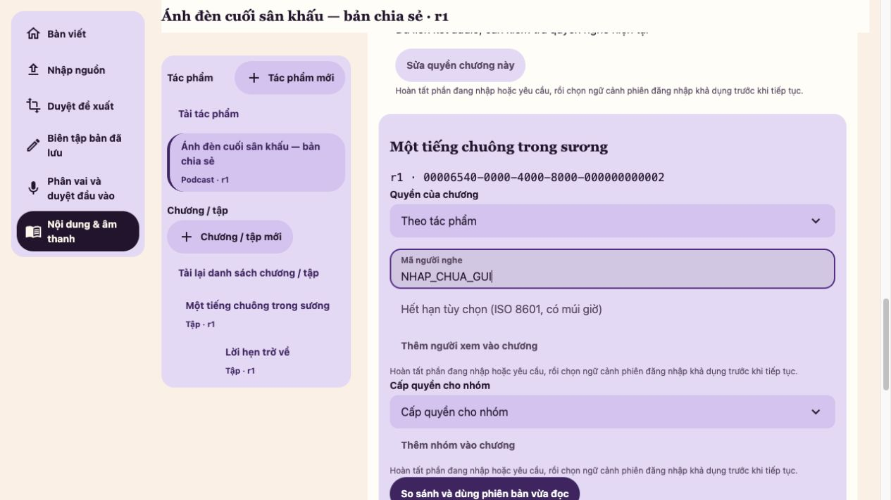
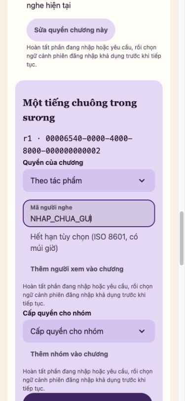

# Unit policy and HIDE — S10 / #656

Implementation baseline: `develop@a1534cff46504dcf9c54431c423f779aa190ae40`.
Local Mac, Rust 1.98.1, embedded Turso 0.8.3. The PR pins the final source head; run logs,
input snapshots, fixture identities and exact counts are retained under
`artifacts/agent-runs/656/` in the task checkout. No production migration/activation occurred.

## Delivered behavior

- One Work policy CAS, immutable event and receipt replaces an exact Unit's INHERIT or
  restricted actor/group projection. No child PUBLIC mode, implicit publication, second active
  Unit pointer or mutable audit history. Expiry is exclusive; empty restriction hides the Unit.
- The existing coherent generation publisher pins an exact selected saved Unit revision/order
  and copies unchanged entries and Work metadata. Studio reuses that command, not an editorial
  head fallback. Audience-only changes do not move generation or editing heads.
- Public/shared metadata, direct Unit/manifest/playback/media reads share current admission.
  Work AND Unit precedes counts, consecutive outward ordinal/position, page hydration and queue
  candidates. Old public URLs and wrong-actor private GET/HEAD/Range/conditional reads deny.
- Public-only Library HIDE precedes keyset/LIMIT. Continue first chooses the account's latest
  chapter; denial cannot fall back to an older visible chapter. Durable owned records and
  historical receipts stay intact. Restricted Library/restore is still unavailable.
- All public/shared/Library walks bind policy/group/publication/expiry and a transactional
  lifecycle/actor clock. Archive and disable/enable do not revive a cursor. Draft-only edits
  do not invalidate an unchanged published pin.
- Studio requests a bounded 20-row chapter matrix: saved/published pins, Work gate, Unit policy
  and audio association. Selection names exactly one loaded row. Dirty policy input survives
  stale/failed reads; reload/compare is explicit. Audio association is not live readiness.
- Web/CMP drop refused snapshots and reread Work/count before Units. Web route departure also
  drops discovery rows and fences late replies, so Back rereads current counts. CMP replaces its known
  queue from the newly admitted detail walk and never treats persisted public JSON as present
  access authority. No renderer invents an ACL decision.

## Independent evidence

| Layer | Evidence and practical limit |
| --- | --- |
| Pure Catalog | Six policy tests, including the independent Work/Unit truth table and replacement bounds, PASS. |
| Real file-backed Turso | Ten new Unit tests PASS: HIDE count/order/page, Work-CAS/owner isolation, foreign groups/Units, expiry, lost ack/reopen/replay, independent group intersection/removal, real Studio routes, schema guards, Library and archive/owner cursor fences. |
| Server library | Initial broad run: 831 PASS, 16 FAIL, 13 explicit ignored. All 16 failed filesystem-root fixtures PASS with canonical task-owned TMPDIR; `/var` symlink refusal was environmental. No production storage validation was weakened. |
| Identity + HTTP + bytes | Six production-router journeys PASS, three explicit ignored. New Unit case admits exact private Range bytes for the current actor, denies stale public/wrong-actor/removed/withdrawn direct URLs and never bypasses Work. Synthetic content/rights and transport bytes do not establish media inspection, listening or production acceptance. |
| Model | Viewer-access, public-playback-delivery and retired-language draft models/runs/witnesses/negative controls PASS, model-only. Pinned Node 24.19.0/npm 11.9.0/Quint 0.33.0; full traces/input snapshots retained in task evidence. No registered Unit SQL/client conformance observer or exhaustive proof is claimed. |
| CMP JVM | Shared 658 PASS/3 skips and preview 183 PASS/4 skips (848 total). Test-only stand-ins and desktop rendering do not qualify Android/iOS media, restore or assistive technology. |
| Web native | Studio 472 PASS, Theatre 585 PASS, web-auth 49 PASS. Final selected-Unit display-only correction uses the existing identity formatter; its Studio rebuild and real browser observation are separate from the preceding native suites. |
| Build/contracts/static | Web lint, both WASM apps and UI preview PASS. Server + consumer contract-tests PASS (248 tests across the selected targets); the aggregate contracts command later FAILS its unchanged wav-reference build from disk exhaustion, leaving audio-inspection NOT_RUN. Android debug build/APK inspection and localization check PASS. No native device was run. |
| Final handoff gate | Preflight FAIL: repository 66 qualification findings and impact:unknown without decision; downstream gates NOT_RUN by that gate. Independently executed layers above retain their own statuses. Earlier disk-full, fixture-root, compile and changed-expectation logs remain unchanged. |

## S11 query inventory

`viewer_reads::candidates` has four indexed actor/group candidate lanes (Work and Unit),
deduplication before bounded lookahead, then current admission. Each admitted Work loads Unit
policy and grants in two bounded statements, at most 1,000 current Unit grants per Work;
Work/group/rights reads remain separate. Public count excludes restricted Units in SQL. Shared
count/ordinal uses the complete at-most-1,000-entry published generation before bounded page
hydration. The Studio matrix is bounded on the wire but reads that generation and two Unit
projections. No full editorial Unit tree is loaded by the matrix.

Library uses correlated Catalog-owned generation/active-owner/Unit-policy predicates before
keyset/LIMIT; Continue retains its account window query. `shared_scope` conservatively reads
global publication/policy/group sums, expiry counts (including Unit grants) and one live clock.
These aggregates/correlated predicates need actual Turso EXPLAIN, statement/row and latency
measurement in #657. Bounded output is not a performance result; no FTS, MVCC, cache, outbox,
production serving or published performance/budget claim is introduced here.

## Acceptance still owed

The metadata-generation model is draft/model-null; listening.progress is needs-decision/model-null.
Client cursor/cache lifecycle has no registered observer. Ten inherited Kani obligations and
UI qualification findings remain unresolved, without waivers or baseline edits. Final preflight retains `impact:unknown` without a decision. Repository checks report 66 UI
qualification findings: the previous #655 run has the same 65, plus the new chapter-panel
Select/TextField consumer. No qualification baseline/hash is changed. These findings belong to
the single #676 review ledger.

Private Web Play remains locked after the #654 teardown failure; native private Play remains
locked until every fetch/seek/refresh carries safe Bearer transport. Restricted cover is null,
restricted Library restoration is unsupported, and ordinary Server assembly stays closed after
startup/restore. iOS Kotlin/Native 2.2.20 is unavailable locally (installed 2.2.0 and 2.4.20 are
not substitutes). Device/accessibility, HTTPS media and paired-restore/production acceptance
remain independent. Browser observation of this matrix cannot qualify these delivery paths.

Studio's matrix labels an audio association rather than implementing a new bulk live-readiness
or global group-impact projection. Full affected-Work group impact and claimed/expired/revoked
share history remain gaps from #654. No issue checkbox is inferred from a source merge.

## Real browser observations

A disposable real Identity/Studio cookie/Turso fixture supplied the actual matrix GET. The
selected Unit/r1 identity and unsent field persisted through reload and the existing narrow
Browse → Unit → Details flow. Light VI at1280×720 and390×844 was observed, with no narrow page
overflow. No policy, publication, sharing or other-account mutation was performed; full keyboard,
AT, touch, dark/large-text/reduced-motion and >20-row visual paging remain unqualified. These
are actual screenshots, not preview qualification records or private-media evidence.

